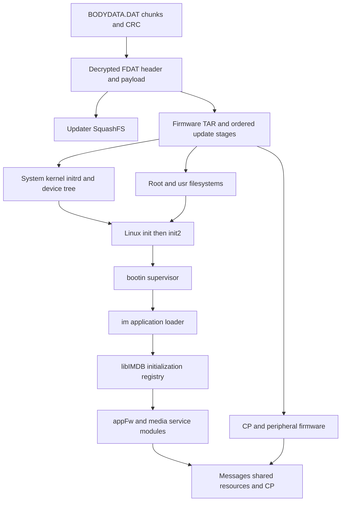
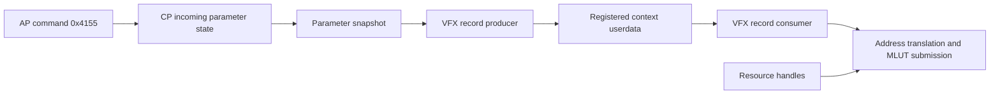

# A7C II firmware architecture and LUT investigation

October 17, 2026. Input: the pinned official ILCE-7CM2 firmware 2.01 already downloaded for this project. No camera connection, module upload, on-camera execution or camera installation was performed for this investigation. Selected CP metadata builders were exercised only in bounded host emulation, with external operations stubbed.

The firmware has two principal software environments: an ARM64 Linux application system and a separate mixed ARM/Thumb imaging system with TOPPERS-FMP/SOLID build evidence. The application is assembled through an initialization registry and dynamically loaded modules. LUT-related code separates into recording metadata, Creative Look color processing, and MLUT hardware configuration. **The ordinary native LUT format and its producer are now recovered. Full-resolution saved-still routing through MLUT remains unproven.** A callback context can be followed through one structurally present sequence, but its recovered selector does not choose that variant for the tested mode domain; a selected alternative still needs classification.

This is a map of inspected bytes and code relationships. Installed firmware, running privileges, usable memory and actual frame behavior on this camera remain unmeasured.

## Reading the investigation

| Report | Coverage |
|---|---|
| [Firmware structure](FIRMWARE_STRUCTURE.md) | Containers, partitions, original filesystem metadata, kernel, startup, initialization registry and updater |
| [AP interfaces](AP_INTERFACES.md) | ELF dependencies, native interfaces, LUT selection enums, CP messages, recording metadata and still APIs |
| [AP native LUT resources](AP_LUT_RESOURCES.md) | Numbered native files, bounded reader, mapped-memory copy and payload-request fields |
| [CP architecture](CP_ARCHITECTURE.md) | Startup and memory map, RTOS clues, message handler, snapshots, VFX records, MLUT drivers and registers |
| [Native LUT format](NATIVE_LUT_FORMAT.md) | Actual CUBE producer, reversible ordinary packing, quantization, parser behavior and alternate-converter boundary |
| [MLUT SRAM/register layout](MLUT_LAYOUT.md) | Named stock tables, exhaustive bank-layout comparisons and register-payload fields |
| [Still MLUT route](STILL_MLUT_ROUTE.md) | Callback identity, selector gate, fallback sequence, resource groups, geometry sources and dimension limits |
| [AP still-recording boundary](STILL_RECORDING_BOUNDARY.md) | Additional REA recording/parameter/virtual-interface evidence and the missing capture-buffer connection |
| [Computer-only LUT reference](LUT_REFERENCE.md) | Bounded CUBE parser, explicit sRGB grading, independent numerical checks and image-output behavior |
| [REA Evidence index](evidence/rea/index.json) | Exact tool results, Evidence IDs, input identities, profiles, limitations, failed requests and session closure |
| [Readable REA pseudocode](evidence/rea/readable/) | Decompiled functions with their original Evidence IDs; not recovered source code |

The standalone mappers use Python, pyelftools, Capstone and the pinned fwtool sources; the CP mapper additionally performs bounded host emulation with Unicorn. Their outputs are explicitly ordinary offline evidence. REA results are independently retained as native REA Evidence rather than relabeling shell observations.

## From the update file to the application



The outer DAT container has a checked CRC32. Its decrypted FDAT describes an updater filesystem and a production firmware TAR. The TAR has configuration, backup, partition, image, loader and peripheral-update stages. The package contains five supplied partition images against **30 configured partitions**, so it is not a complete flash dump or a substitute for this body's own backup.

The Linux kernel banner identifies **4.9.337-scel+**, ARM64, a Sony CE Linux build; the shipped libc is **glibc 2.25**. The chassis configuration names **CXD90057+CXD90058**, and the device tree identifies CXD90057. The CP is not included in the ELF architecture counts: its raw image uses privileged ARM bootstrap code and predominantly Thumb-2 routines in the inspected imaging regions.

The broad inventory covers **1,369 extracted regular files** and **650 ELF files**, including **128 kernel modules** and nested updater duplicates. The narrower AP dependency graph covers the partition-image extraction subtree: **619 AArch64 ELF files and 2,714 DT_NEEDED edges**. Those boundaries explain the different ELF counts; neither number counts running processes.

## The boot and module-loading system

Static startup configuration leads from the initrd to the partition-7 root filesystem, `init2`, and `bootin.elf`. REA decompilation corroborates `bootin` startup orchestration and its continuing OSAL message loop. It constructs an `im.elf` launch command through a separate helper; not every runtime flag or helper effect has been recovered.

`im.elf` uses the initialization registry exported by `libIMDB.so`. The recovered layout has a `0x100`-byte header and **72-byte records**, with **236 records including the sentinel**. Records contain library and initializer names plus masks, phase information and lifecycle fields. The entry for `appFw.so` names `Application_System_Init`; service and media modules have their own entries.

REA shows the loader calling `dlopen`, resolving initializer names with `dlsym`, and invoking the resolved functions. A record field can route loading through `/usr/lib/libObj.so` rather than the logical module name. This helps explain why ordinary ELF dependency edges alone do not describe the application. It does not establish every module's selected runtime route or initializer order on this body. [Registry layout and exact REA records](FIRMWARE_STRUCTURE.md#5-application-bootstrap-and-recovered-registry).

## Filesystem facts that affect custom programs

| Area | Shipped configuration | Consequence |
|---|---|---|
| Root filesystem | Partition 7, ext2, read-only mount configuration | The ordinary application environment is separate from updater tools |
| `/usr` | Partition 15, ext2, read-only mount configuration | Program libraries reside here; controlled remounting is a separate operation |
| `/cp` | Partition 8, FAT | Contains CP firmware and related processor resources |
| `/tmp` | Partition 10, 12 MiB FAT, also mounted at `/etc` and `/var` | Do not assume a large RAM-backed temporary directory |
| `/tmp_wbshd` | Separate tmpfs | Distinct from the persistent `/tmp` mount |
| `/usr/data/lut` | Partition 30, 22 MiB, FAT, in update mount configuration | Dedicated LUT storage is configured; later runtime mounting still needs tracing |
| WBI | Partition 5, 300 MiB configured, supplied image begins WBI2 | Saved runtime state must be considered separately from disk files |

The original extraction omitted symlinks and special files. Reading the source ext2 metadata recovered **225 symlinks**, including the shell and ARM64 dynamic-loader links. Apparent missing paths in the extracted host tree therefore cannot be treated as missing files on the camera.

The supplied `mem=4G` configuration and larger device-tree memory aperture do not establish free RAM or even a single authoritative physical-memory figure. Reserved regions, warm-boot state and the actual running configuration still matter. A full 33 MP RGB8 frame needs roughly 94 MiB, already much larger than the configured `/tmp` partition.

## What the service loader establishes

REA decompilation of `libJiritsu.so` corroborates a special case in the SET_FILE2 handler: after a complete write to the designated `libJit.so` path, the handler calls `dlopen` and then `dlclose`. The library initialization routine can therefore perform a one-shot task when the loader admits the object. A separate JIT execution thread supports named script interfaces; it is a distinct route, not a requirement for the existing one-shot workers. [SET_FILE2 Evidence](evidence/rea/jiritsu-exact/02-procedure_pseudo_code.json), [JIT thread Evidence](evidence/rea/jiritsu-exact/03-procedure_pseudo_code.json).

This gives a concrete code basis for the repository's native workers. Privileges still depend on the hosting process: the project's probe checks the effective UID, and no fresh probe was run on this body. A privileged Linux worker does not automatically provide the CP's RTOS ABI, a persistent application lifecycle, a safe image buffer interface, or an accepted modified Sony update container.

## Three LUT mechanisms must be kept separate

### Recording metadata

`mpr::SetLutData` parses a CUBE file and constructs recording data. The recovered representation includes an outer ELUT header, a SonyLookControl KLV prefix, an inner SONYBCUB object and float32 RGB triples. The size formula is:

```text
45 + 0xd00 + 12 × N³
```

For N=33, that equals the observed `0x6a1b9` allocation. Writer-side consumers copy the resulting pointer/size/name data into recording records. This is substantive evidence for an embedded-LUT metadata role; it must not be used as proof that calling the function grades pixels. [Recovered fields and format](AP_INTERFACES.md).

Two tempting names also have narrower meanings than the initial string survey could establish. `SELECT_LUT_SDR_STILL` is rendering-preset enum value 2, alongside S-Cinetone and Standard. The mode values 1–3 in `send_lut_procam` identify Flexible ISO, Cine EI Quick and Cine EI configurations, not still/movie capture modes. Shared enum names do not prove those features are enabled in this model's UI.

### User LUT control and MLUT

AP instructions build a **96-byte command `0x4155`**. Its submitter allocates and copies the envelope, then uses kernel-mediated OSAL messaging. This command passes no response buffer and skips the explicit response-future wait; its zero result is not CP or frame completion. Referenced LUT buffers are not deep-copied by that helper. The independently identified CP handler resolves shared-resource addresses, registers two 64-bit payload addresses, their lengths and a look name, and updates a counter. The data is part of a larger parameter structure that is copied into processing snapshots.

A VFX parameter builder copies the supplied-LUT fields into a record when selector `0x0a` is active. Consumer wrappers pass that record to a VFX/MLUT submission function. Its branches translate addresses and call MLUT SRAM, look-selection and optional register-data submission routines.

The new callback trace establishes a specific context identity: the sequence passes context C to the builder, registers C as callback userdata, and the actual list dispatcher and adapters forward C to the consumer. **This is structural control flow, not a demonstrated live frame path.** The recovered selector's property gate is zero for all 65,536 tested 16-bit modes, so that selector does not choose this particular sequence variant. A neighboring selected alternative also contains builder and consumer callbacks. Its runtime geometry sources are traced, but their values and still/movie/display meaning are not established. The control relationship is:



A separate diagnostic path reaches actual register-update instructions for **seven MLUT block bases**, from `0xf4009000` through `0xf4609000`. It validates IP, flow and 3D-mode ranges before updating selected register fields. The precise still/movie/display port meanings remain unknown; no register was accessed on hardware. [Instruction traces and limitations](CP_ARCHITECTURE.md).

The lower-level SRAM loader requires exactly **48,000 bytes**; its optional register-data companion requires **124 bytes**. Their queue copies only 56 bytes of metadata and retains the payload pointers. A later descriptor builder divides SRAM data into 24 chunks of 2,000 bytes, while register data covers 31 words. The earlier bounded host checks passed 48 wrapper cases and four descriptor-builder cases; they stub external operations and do not exercise DMA, the worker queue or imaging hardware. The later producer and stock-table work establishes the numerical storage layout independently of these lengths. [Native transfer contract](CP_ARCHITECTURE.md#below-the-mlut-payload-loaders-exact-lengths-and-banked-transfers).

The AP resource path formats numbered names such as **`/usr/data/lut/LUT001.LUT`**, reads their bytes, and copies them through a mapped-memory helper before dispatching resource IDs and length. The examined outer selection branch reaches 16 indices; a wider internal bound does not establish 50 UI slots. The producer writes native bytes and the original `.cube` text separately. [Resource trace](AP_LUT_RESOURCES.md), [producer and paired writer](NATIVE_LUT_FORMAT.md).

### Recovered ordinary native payload

The ordinary CUBE path quantizes each finite output channel with Float64 fused `value × 8192 + 0.5`, clamps to 0–65535, and stores uint16 values. It accepts 17/33-point grids; the 33-point branch retains every second node, producing the same **17³ active grid**. The 48,000-byte payload contains **R/G/B planes × eight parity banks × 1,000 little-endian halfwords**. Coordinates beyond 16 are zero-padded. The exact mapping has an independent Python inverse and is corroborated by all 24,000 halfwords of named CP identity tables.

Ten original-packer cases matched **480,000 bytes**, and inverse checks recovered **147,390 retained samples**. Eighteen parser/writer/boundary checks additionally expose compatibility differences: tested `DOMAIN_MIN/MAX` lines are ignored, nondefault `LUT_3D_INPUT_RANGE` is rejected, and extra complete rows are ignored. These are bounded original-instruction tests with explicit libc stubs, not a general parser-conformance claim.

The branch selector is model parameter **`0x1a5d`, `import_lut_hq_conversion`**: OFF selects ordinary packing and ON selects the alternate vendor converter. The runtime value and product defaults remain unmeasured. The alternate branch prepares blue-fastest float4 input, passes separate output pointers at buffer offsets 0 and 48,000 to that converter, and returns a 48,128-byte descriptor. Its converter was intercepted at entry, so complete alternate serialization and the remaining four bytes are unresolved. Both examined normal import paths remove existing native/text files before writing replacements; the low-level writer's missing `O_TRUNC` does not establish a retained-tail bug in that workflow. The correct color domain for a still-image stage is still unresolved.

The register work independently recovers the overall-enable, CPU-access, bank/channel, pre/post-black and RGB switch fields. All **128** isolated switch-builder cases pass. Input threshold meaning and silicon interpolation remain distinct from the AP output quantizer. [Native format](NATIVE_LUT_FORMAT.md), [stock tables and register fields](MLUT_LAYOUT.md).

### What the still trace does and does not establish

The resource lookup maps four ownership slots into seven single/combined indices. The dimension validation and register setters accept 7008 × 4672 in host memory and use 15-bit fields. **That establishes API representability, not supported hardware dimensions, throughput or saved-still routing.** The new CP pass covers 32 decoded regions and 65,621 bounded host cases, including exhaustive mode-gate checks; it does not process an image.

The AP recording pass adds ten real REA records and eight complete instruction ranges. It follows descriptor copying, media-object adapters, metadata and worker queues. Unresolved virtual operations and buffer ownership prevent treating `mpr::RecordStill` as a ready-made pre-encode pixel hook. The decisive missing connection is still a real full-resolution development buffer routed through the selected MLUT resource into the saved-frame encoder. [CP route](STILL_MLUT_ROUTE.md), [AP recording boundary](STILL_RECORDING_BOUNDARY.md).

### Creative Look and CamCore tables

The FL2/FL3 port modifies native look dispatch, tone curves, chroma and matrices. An examined CamCore branch independently builds **405 packed words, 1,620 bytes**, matching its buffer stride and copy size. That format is distinct from the general CUBE metadata grid and the recovered ordinary MLUT payload. Having a three-dimensional color table somewhere in the camera does not establish interchangeability among these mechanisms.

## How REA was used

[REA](https://github.com/morluto/rea) version **6.5.0** was acquired locally and used through its public stdio MCP entry point with **Ghidra 12.1.4**. A project-local, checksum-verified Temurin 21 runtime and a native macOS ARM64 decompiler build supplied the backend. The analysis creates temporary Ghidra databases, not camera processes. Agent registration and global tool configuration were not changed.

[Toolchain identities](toolchains/rea.json), [the static-query driver](run_rea.mjs), and [the evidence index](evidence/rea/index.json) retain the boundaries. The REA firmware-region adapters require Linux tooling in this release; Sony container decoding used the already-pinned fwtool instead. Mixed ARM/Thumb CP analysis used an explicit recovered map and Capstone rather than claiming unsupported raw-Thumb REA results.

The retained results comprise **42 successful REA Evidence records, including 35 pseudocode records, across six binary identities**. Default Ghidra analysis completed for the large `appFw.so`; its main LUT selection helper corroborates the instruction map. The separate procam helper was not recognized as a procedure by that database, so its failed query is retained and its instructions remain separately labeled Capstone evidence. The alternate profile without automatic switch recovery was stopped after the default run completed; no results are claimed from it. All twelve sessions in the retained REA index have explicit successful close receipts, including unsuccessful/cancelled attempts. Earlier JDK setup failures are documented separately in the toolchain record.

Pseudocode was checked against instruction-level evidence. In particular, missing output-pointer effects can make the CUBE prefix length appear zero, and an incompletely modeled virtual call can make metadata branches appear unreachable. These are decompiler-model limitations, not proof that the firmware lacks those effects. Failed selector requests are retained separately and excluded from successful Evidence counts.

## Reproducing the offline checks

The [verification record](evidence/deep-dive-verification.json) checks concrete source hashes, cross-report counts, REA Evidence identities/session closure, host LUT checks and unchanged deployment assets. With the extracted inputs and project-local dependencies present, run from the repository root:

```sh
.venv-research/bin/python research/map_firmware_structure.py
.venv-research/bin/python research/map_ap_interfaces.py
.venv-research/bin/python research/map_ap_lut_resources.py
.venv-research/bin/python research/map_cp_architecture.py
.venv-research/bin/python research/trace_native_lut.py
.venv-research/bin/python research/trace_mlut_layout.py
.venv-research/bin/python research/trace_still_mlut.py
.venv-research/bin/python research/trace_still_recording.py
.venv-research/bin/python research/check_lut_reference.py
.venv-research/bin/python research/summarize_rea.py
.venv-research/bin/python research/verify_deep_dive.py
.venv-research/bin/python research/index_evidence.py
```

The CP mapper includes its bounded host-emulation cases. The retained REA results are indexed by `summarize_rea.py`; creating new REA results uses the separate [toolchain/job instructions](toolchains/README.md). None of these commands connects to the camera.

## Questions now answered and still open

| Question | Status |
|---|---|
| How is the official update organized? | Container, decoded header, TAR stages and configured partition map recovered |
| What software environments exist? | ARM64 Linux/glibc AP and separate ARM/Thumb CP with RTOS build evidence |
| How does the application load? | Init scripts, boot supervisor, loader code and structured initialization registry recovered |
| Why can a temporary native module execute? | SET_FILE2's designated-path `dlopen` special case corroborated; this body's privileges unmeasured |
| What do AP LUT APIs do? | Recording metadata and a separate CP control message identified and mapped |
| What is the native LUT payload? | Ordinary 48,000-byte format, producer, quantization and inverse recovered; alternate converter's full serialization remains unresolved |
| Does supplied LUT state reach imaging-control code? | Snapshot/builder and callback identity structurally joined for one variant; its selector gate and the selected alternative prevent a live-frame claim |
| Can arbitrary LUTs be baked into full-resolution stills? | Unresolved: actual selected still route, buffer/color domain and ownership/completion contract |
| Can the official update be repacked and accepted? | Not established; decryptability and CRC checks do not prove authenticity/signature acceptance |
| Can a damaged camera always be recovered? | Not established; neither a complete flash backup nor a verified power-loss recovery procedure exists |

The next firmware work is to classify the selected alternative sequence, follow its runtime geometry and pixel buffers into a saved-frame encoder, complete alternate LUT serialization, and recover completion/cancellation and DMA ownership. The [host reference LUT processor](LUT_REFERENCE.md) is implemented separately: its 17/33-point CUBE evaluation passed 8,016 OpenColorIO comparisons, plus independent analytic/scalar and image-output checks. It is a computer-only numerical reference, with full-frame Pillow allocations and no camera performance claim. No installer or live camera experiment follows automatically from this map.
