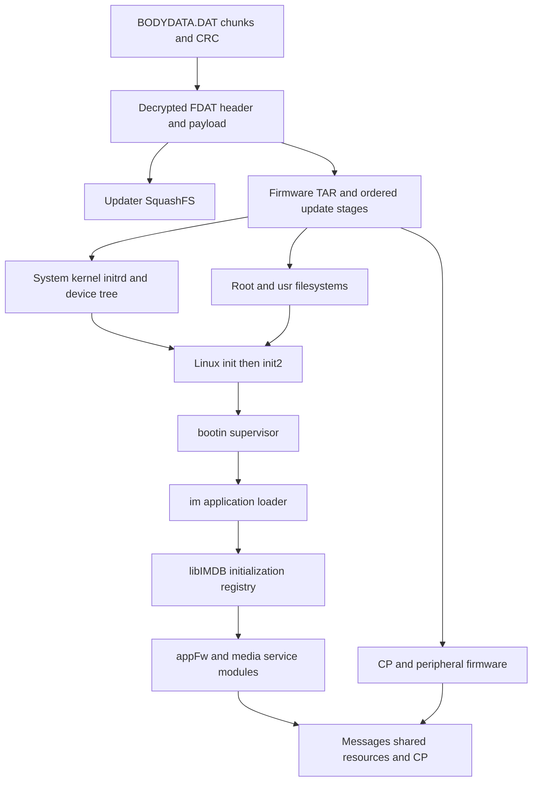
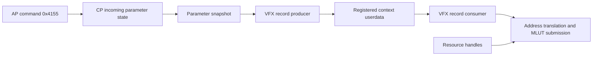

# A7C II firmware architecture and LUT investigation

Updated October 18, 2026. Input: the pinned official ILCE-7CM2 firmware 2.01 already downloaded for this project. No camera connection, module upload, on-camera execution or camera installation was performed for this investigation. Selected original routines were exercised only in bounded host emulation, with external operations stubbed.

The inspected software includes an ARM64 Linux application system, a separate mixed ARM/Thumb CP image with TOPPERS-FMP/SOLID build evidence, and an additional AArch64 `av-cam.bin` image containing concrete still-notification and encoder handlers. Its physical processor assignment and live scheduling remain unestablished. The application is assembled through an initialization registry and dynamically loaded modules. LUT-related code separates into recording metadata, Creative Look color processing, and MLUT hardware configuration. **The ordinary native LUT format is recovered, and the HQ converter executes offline through its actual serializer. Full-resolution saved-still routing through MLUT remains unproven.** The selected CP path conditionally uses a direct resource ring or a regular DMM allocation, followed by a state-gated share. The allocation's live lineage into av-cam's encoder input remains missing. Native capture HEIF completion and output handoff are now traced independently of the generic AP conversion tables.

This is a map of inspected bytes and code relationships. Installed firmware, running privileges, usable memory and actual frame behavior on this camera remain unmeasured.

## Reading the investigation

| Report | Coverage |
|---|---|
| [Firmware structure](FIRMWARE_STRUCTURE.md) | Containers, partitions, original filesystem metadata, kernel, startup, initialization registry and updater |
| [AP interfaces](AP_INTERFACES.md) | ELF dependencies, native interfaces, LUT selection enums, CP messages, recording metadata and still APIs |
| [AP native LUT resources](AP_LUT_RESOURCES.md) | Numbered native files, bounded reader, mapped-memory copy and payload-request fields |
| [CP architecture](CP_ARCHITECTURE.md) | Startup and memory map, RTOS clues, message handler, snapshots, VFX records, MLUT drivers and registers |
| [Native LUT format](NATIVE_LUT_FORMAT.md) | Actual CUBE producer, reversible ordinary packing, quantization, parser behavior and alternate-converter boundary |
| [HQ LUT format](HQ_LUT_FORMAT.md) | Original vendor conversion, populated grid, numeric packing and 128-byte register serialization |
| [Native LUT transfer](LUT_TRANSFER.md) | AP staging/destination resources, kernel DMA descriptor construction and a bounded fragmented-allocation counterexample |
| [CP JPEG encoder boundary](STILL_ENCODER_ROUTE.md) | Named request descriptors, image geometry, work-buffer validation and unresolved MLUT join |
| [AP saved-file sink](STILL_SINK.md) | Resolved JPEG/HEIF methods, finalization, area lists, asynchronous filesystem submission and callback |
| [MLUT/pixel/encoder link](MLUT_ENCODER_LINK.md) | Same-context ownership, resource-ring address through pixel-port records, command-7 gate and the remaining SDYC join |
| [AP JPEG command bridge](AVBBC_ENCODER_BRIDGE.md) | Native JPEG request/completion, dataflow envelope and missing HEIF command-conversion entry |
| [HEIF encoder](HEIF_ENCODER.md) | MC request/result ABI, open/close and conditional 27-command resize/encode sequence |
| [Notification-to-save link](ENCODER_SAVE_LINK.md) | Message 0x1006 descriptor copies, registered callback, queue tag 9 and RecordStill pointer identity |
| [AP SSYC metadata](SDYC_METADATA.md) | Original AP metadata serialization with a nested pixel descriptor, independently cross-decoded by CP |
| [CP SDYC backing mapping](SDYC_MAPPING.md) | Segmented handle/offset resolution, SSYC entry parser and nested pixel address in the JPEG object |
| [Still-info producer](STILL_INFO_PRODUCER.md) | av-cam notification construction and its connection to the AP recording boundary |
| [HEIF binding and receiver](HEIF_BINDING.md) | AP activation/initialization, missing translation entries and av-cam native receive/completion IDs |
| [Conditional MLUT allocation](MLUT_ALLOCATION.md) | Live-global predicate, ring versus DMM allocation, continuous allocation/share fragment and missing encoder export |
| [av-cam encoder pixels](AV_CAM_PIXELS.md) | Resize-output handle to encoder-input slot, extent query, JPEG pixel offset and hardware-address encoding |
| [Native HEIF ownership](HEIF_OWNERSHIP.md) | Direct native capture request, completion, output tracker detach, area publication and codec close |
| [av-cam MLUT boundary](AV_CAM_MLUT.md) | Diagnostic registry, dimension dispatcher and bounded direct-call references; no demonstrated still-buffer join |
| [AP recording ownership](RECORDING_BUFFER_OWNERSHIP.md) | Non-cache share-before-free ordering, HEIF area identity and deduplicated original-reference cleanup |
| [MLUT SRAM/register layout](MLUT_LAYOUT.md) | Named stock tables, exhaustive bank-layout comparisons and register-payload fields |
| [Still MLUT route](STILL_MLUT_ROUTE.md) | Callback identity, selector gate, fallback sequence, resource groups, geometry sources and dimension limits |
| [AP still-recording boundary](STILL_RECORDING_BOUNDARY.md) | Additional REA recording/parameter/virtual-interface evidence and the missing capture-buffer connection |
| [Computer-only LUT reference](LUT_REFERENCE.md) | Bounded CUBE parser, explicit sRGB grading, independent numerical checks and image-output behavior |
| [REA Evidence index](evidence/rea/index.json) | Exact tool results, Evidence IDs, input identities, profiles, limitations, failed requests and session closure |
| [Readable REA pseudocode](evidence/rea/readable/) | Decompiled functions with their original Evidence IDs; not recovered source code |

The standalone mappers use Python, pyelftools, Capstone and the pinned fwtool sources; the CP mapper additionally performs bounded host emulation with Unicorn. Their outputs are explicitly ordinary offline evidence. REA results are independently retained as native REA Evidence rather than relabeling shell observations.

## From the update file to the application



The outer DAT container has a checked CRC32. Its decrypted FDAT describes an updater filesystem and a production firmware TAR. The TAR has configuration, backup, partition, image, loader and peripheral-update stages. The package contains five supplied partition images against **30 configured partitions**, so it is not a complete flash dump or a substitute for this body's own backup.

The Linux kernel banner identifies **4.9.337-scel+**, ARM64, a Sony CE Linux build; the shipped libc is **glibc 2.25**. The chassis configuration names **CXD90057+CXD90058**, and the device tree identifies CXD90057. The CP is not included in the ELF architecture counts: its raw image uses privileged ARM bootstrap code and predominantly Thumb-2 routines in the inspected imaging regions.

The broad inventory covers **1,369 extracted regular files** and **650 ELF files**, including **128 kernel modules** and nested updater duplicates. The narrower AP dependency graph covers the partition-image extraction subtree: **619 AArch64 ELF files and 2,714 DT_NEEDED edges**. Those boundaries explain the different ELF counts; neither number counts running processes.

## The boot and module-loading system

Static startup configuration leads from the initrd to the partition-7 root filesystem, `init2`, and `bootin.elf`. REA decompilation corroborates `bootin` startup orchestration and its continuing OSAL message loop. It constructs an `im.elf` launch command through a separate helper; not every runtime flag or helper effect has been recovered.

`im.elf` uses the initialization registry exported by `libIMDB.so`. The recovered layout has a `0x100`-byte header and **72-byte records**, with **236 records including the sentinel**. Records contain library and initializer names plus masks, phase information and lifecycle fields. The entry for `appFw.so` names `Application_System_Init`; service and media modules have their own entries.

REA shows the loader calling `dlopen`, resolving initializer names with `dlsym`, and invoking the resolved functions. A record field can route loading through `/usr/lib/libObj.so` rather than the logical module name. This helps explain why ordinary ELF dependency edges alone do not describe the application. It does not establish every module's selected runtime route or initializer order on this body. [Registry layout and exact REA records](FIRMWARE_STRUCTURE.md#5-application-bootstrap-and-recovered-registry).

## Filesystem facts that affect custom programs

| Area | Shipped configuration | Consequence |
|---|---|---|
| Root filesystem | Partition 7, ext2, read-only mount configuration | The ordinary application environment is separate from updater tools |
| `/usr` | Partition 15, ext2, read-only mount configuration | Program libraries reside here; controlled remounting is a separate operation |
| `/cp` | Partition 8, FAT | Contains CP firmware and related processor resources |
| `/tmp` | Partition 10, 12 MiB FAT, also mounted at `/etc` and `/var` | Do not assume a large RAM-backed temporary directory |
| `/tmp_wbshd` | Separate tmpfs | Distinct from the persistent `/tmp` mount |
| `/usr/data/lut` | Partition 30, 22 MiB, FAT, in update mount configuration | Dedicated LUT storage is configured; later runtime mounting still needs tracing |
| WBI | Partition 5, 300 MiB configured, supplied image begins WBI2 | Saved runtime state must be considered separately from disk files |

The original extraction omitted symlinks and special files. Reading the source ext2 metadata recovered **225 symlinks**, including the shell and ARM64 dynamic-loader links. Apparent missing paths in the extracted host tree therefore cannot be treated as missing files on the camera.

The supplied `mem=4G` configuration and larger device-tree memory aperture do not establish free RAM or even a single authoritative physical-memory figure. Reserved regions, warm-boot state and the actual running configuration still matter. A full 33 MP RGB8 frame needs roughly 94 MiB, already much larger than the configured `/tmp` partition.

## What the service loader establishes

REA decompilation of `libJiritsu.so` corroborates a special case in the SET_FILE2 handler: after a complete write to the designated `libJit.so` path, the handler calls `dlopen` and then `dlclose`. The library initialization routine can therefore perform a one-shot task when the loader admits the object. A separate JIT execution thread supports named script interfaces; it is a distinct route, not a requirement for the existing one-shot workers. [SET_FILE2 Evidence](evidence/rea/jiritsu-exact/02-procedure_pseudo_code.json), [JIT thread Evidence](evidence/rea/jiritsu-exact/03-procedure_pseudo_code.json).

This gives a concrete code basis for the repository's native workers. Privileges still depend on the hosting process: the project's probe checks the effective UID, and no fresh probe was run on this body. A privileged Linux worker does not automatically provide the CP's RTOS ABI, a persistent application lifecycle, a safe image buffer interface, or an accepted modified Sony update container.

## Three LUT mechanisms must be kept separate

### Recording metadata

`mpr::SetLutData` parses a CUBE file and constructs recording data. The recovered representation includes an outer ELUT header, a SonyLookControl KLV prefix, an inner SONYBCUB object and float32 RGB triples. The size formula is:

```text
45 + 0xd00 + 12 × N³
```

For N=33, that equals the observed `0x6a1b9` allocation. Writer-side consumers copy the resulting pointer/size/name data into recording records. This is substantive evidence for an embedded-LUT metadata role; it must not be used as proof that calling the function grades pixels. [Recovered fields and format](AP_INTERFACES.md).

Two tempting names also have narrower meanings than the initial string survey could establish. `SELECT_LUT_SDR_STILL` is rendering-preset enum value 2, alongside S-Cinetone and Standard. The mode values 1–3 in `send_lut_procam` identify Flexible ISO, Cine EI Quick and Cine EI configurations, not still/movie capture modes. Shared enum names do not prove those features are enabled in this model's UI.

### User LUT control and MLUT

AP instructions build a **96-byte command `0x4155`**. Its submitter allocates and copies the envelope, then uses kernel-mediated OSAL messaging. This command passes no response buffer and skips the explicit response-future wait; its zero result is not CP or frame completion. Referenced LUT buffers are not deep-copied by that helper. The independently identified CP handler resolves shared-resource addresses, registers two 64-bit payload addresses, their lengths and a look name, and updates a counter. The data is part of a larger parameter structure that is copied into processing snapshots.

A VFX parameter builder copies the supplied-LUT fields into a record when selector `0x0a` is active. Consumer wrappers pass that record to a VFX/MLUT submission function. Its branches translate addresses and call MLUT SRAM, look-selection and optional register-data submission routines.

The new callback trace establishes a specific context identity: the sequence passes context C to the builder, registers C as callback userdata, and the actual list dispatcher and adapters forward C to the consumer. **This is structural control flow, not a demonstrated live frame path.** The recovered selector's property gate is zero for all 65,536 tested 16-bit modes, so that selector does not choose this particular sequence variant. A neighboring selected alternative also contains builder and consumer callbacks. Its runtime geometry sources are traced, but their values and still/movie/display meaning are not established. The control relationship is:



A separate diagnostic path reaches actual register-update instructions for **seven MLUT block bases**, from `0xf4009000` through `0xf4609000`. It validates IP, flow and 3D-mode ranges before updating selected register fields. The precise still/movie/display port meanings remain unknown; no register was accessed on hardware. [Instruction traces and limitations](CP_ARCHITECTURE.md).

The lower-level SRAM loader requires exactly **48,000 bytes**; its optional register-data companion requires **124 bytes**. Their queue copies only 56 bytes of metadata and retains the payload pointers. A later descriptor builder divides SRAM data into 24 chunks of 2,000 bytes, while register data covers 31 words. The earlier bounded host checks passed 48 wrapper cases and four descriptor-builder cases; they stub external operations and do not exercise DMA, the worker queue or imaging hardware. The later producer and stock-table work establishes the numerical storage layout independently of these lengths. [Native transfer contract](CP_ARCHITECTURE.md#below-the-mlut-payload-loaders-exact-lengths-and-banked-transfers).

The AP resource path formats numbered names such as **`/usr/data/lut/LUT001.LUT`**, reads their bytes, and copies them through a mapped-memory helper before dispatching resource IDs and length. The examined outer selection branch reaches 16 indices; a wider internal bound does not establish 50 UI slots. The producer writes native bytes and the original `.cube` text separately. [Resource trace](AP_LUT_RESOURCES.md), [producer and paired writer](NATIVE_LUT_FORMAT.md).

### Recovered ordinary native payload

The ordinary CUBE path quantizes each finite output channel with Float64 fused `value × 8192 + 0.5`, clamps to 0–65535, and stores uint16 values. It accepts 17/33-point grids; the 33-point branch retains every second node, producing the same **17³ active grid**. The 48,000-byte payload contains **R/G/B planes × eight parity banks × 1,000 little-endian halfwords**. Coordinates beyond 16 are zero-padded. The exact mapping has an independent Python inverse and is corroborated by all 24,000 halfwords of named CP identity tables.

Ten original-packer cases matched **480,000 bytes**, and inverse checks recovered **147,390 retained samples**. Eighteen parser/writer/boundary checks additionally expose compatibility differences: tested `DOMAIN_MIN/MAX` lines are ignored, nondefault `LUT_3D_INPUT_RANGE` is rejected, and extra complete rows are ignored. These are bounded original-instruction tests with explicit libc stubs, not a general parser-conformance claim.

The branch selector is model parameter **`0x1a5d`, `import_lut_hq_conversion`**: OFF selects ordinary packing and ON selects the HQ vendor converter. The runtime value and product defaults remain unmeasured. The HQ branch prepares blue-fastest float4 input. The newer host harness executes its original conversion and serializer rather than intercepting the converter entry: it emits 48,000 SRAM bytes and **128 register bytes**, comprising 124 content bytes plus four zero bytes from the original 32-byte alignment loop. CP consumes the 124 content bytes. A separate [section trace](evidence/hq-sections.json) captures the actual 124→128 emitter call, all four original padding stores, and 28 isolated alignment checks. Identity and channel-permutation fixtures establish a fully populated **20³ grid** with narrower-range thresholds in the tested identities, instead of ordinary conversion's padded 17³ grid. The independent quantizer check and exact byte-layout coverage are recorded in [HQ LUT format](HQ_LUT_FORMAT.md). A separate [coordinate check](evidence/hq-coordinates.json) recovers fixed Float64 endpoint constants near 0.092864 and 0.868998 and a Float32 affine mapping that exactly matches all 24,000 captured identity samples and all 20 register thresholds. These coordinate anchors are not identified as clipping levels or a color standard; upstream nonlinear resampling and the general color-domain contract remain unresolved.

Both examined normal import paths remove existing native/text files before writing replacements; the low-level writer's missing `O_TRUNC` does not establish a retained-tail bug in that workflow. [Transfer tracing](LUT_TRANSFER.md) now proves that AP copies to a staging resource, transfers with source/destination offsets zero, and forwards the destination ID into LUT registration inputs. A kernel descriptor-builder counterexample with synthetic fragmented resources emits 54,939 bytes for 48,000/48,128-byte requests. Single-segment fixtures emit exactly the requested length. This is a bounded warning about a proposed custom resource contract, not a demonstrated overrun during normal camera LUT import; neither DMA nor a camera was exercised.

The register work independently recovers the overall-enable, CPU-access, bank/channel, pre/post-black and RGB switch fields. All **128** isolated switch-builder cases pass. Input threshold meaning and silicon interpolation remain distinct from the AP output quantizer. [Native format](NATIVE_LUT_FORMAT.md), [stock tables and register fields](MLUT_LAYOUT.md).

### What the still trace does and does not establish

The resource lookup maps four ownership slots into seven single/combined indices. The dimension validation and register setters accept 7008 × 4672 in host memory and use 15-bit fields. **That establishes API representability, not supported hardware dimensions, throughput or saved-still routing.** The new CP pass covers 32 decoded regions and 65,621 bounded host cases, including exhaustive mode-gate checks; it does not process an image.

The newer CP pass recovers a native JPEG request with firmware-named `inputYcSdsUnitType/Handle/DataOffset`, stream descriptors, `jpegImageSizeX/Y`, and an optional work-buffer extent of `2*w*h` using 32-bit arithmetic. A synthetic 7008 × 4672 request produces 65,482,752 bytes at that check. Geometry transport and capacity checks execute as isolated host cases, with descriptor resolution and common initialization stubbed. The processing chain reaches `ModuleEncodeJpeg`, `WrapJpegEncode`, a start/wait boundary and result getters. A scalar propagates into a later notification header; its relationship to a two-byte SOI addition makes encoded length a supported inference. Generic delivery occurs **after** processing and must not be described as the encoder invocation. These are software contracts and static relationships, not successful hardware encoding or a hardware-resolution claim. [CP JPEG boundary](STILL_ENCODER_ROUTE.md).

The AP pass resolves JPEG/ARW/HEIF vtables and separates normal finalization at virtual slot `+0x18` from a conversion branch at `+0x40`. Both construct area records consumed by the asynchronous file writer. The normal JPEG finalizer copies a supplied area descriptor rather than providing a demonstrated RGB hook. The writer consumes object `+0x11f0` / `+0x11f8`, builds pointer/length vectors and calls `Fsys_WriteDirectFileAsyncV2`, with a separate callback into a write-finished queue. The preceding AP queue handler classifies two 0x2fc-byte result records and forwards JPEG/RAW/HEIF pointers into `RecordStill`. [AP recording boundary](STILL_RECORDING_BOUNDARY.md), [resolved saved-file sink](STILL_SINK.md).

The **notification-to-save descriptor link** is traced: AP message `0x1006` supplies two typed image records, the worker copies them into an allocated payload, and a registered callback passes that same pointer through queue tag 9 to the recording handler. Eighteen host cases cover all JPEG/RAW/HEIF pairs in both diagnostic-preprocessor branches. The October 18 producer follow-up below connects this input to av-cam construction. [Notification/save evidence](ENCODER_SAVE_LINK.md).

On the imaging side, the context address reaches four pixel-port parameter blocks and MLUT/pixel configuration share a context owner. The latest pass corrects the earlier ring-only description: the live-global predicate selects either the direct ring record or a regular DMM handle allocation. A continuous original fragment follows regular allocation into a state-gated DMM share, including a newly returned handle. Neither that handle nor its backing has been joined to the capture input in av-cam. Shared handles can differ while referring to the same backing, so numeric handle inequality is not evidence of separate images. [Allocation branches and share](MLUT_ALLOCATION.md), [earlier pixel parameters](MLUT_ENCODER_LINK.md).

The SDYC trace independently explains an outer metadata handle and nested pixel handle/offset. The CP JPEG command-7 fields align with AP JPEG fields displaced by `0x1c`, but that receive dispatch/prefix construction remains missing. These contracts do not close the CP-to-av-cam allocation/export link. [SDYC metadata](SDYC_METADATA.md), [segmented mapping](SDYC_MAPPING.md), [AP command transport](AVBBC_ENCODER_BRIDGE.md).

The capture-specific JPEG and normal-mode HEIF stages in av-cam consume the same per-slot input handle/geometry records. Original resize Post code transfers its output handle into those exact input slots. The materializer queries a DMM extent, and the JPEG request builder applies a geometry-dependent byte offset and an explicit address-alias conversion. This joins **resize output to encoder input locally**, while the producer upstream of that resize and its relation to CP MLUT remain unresolved. [Encoder pixel evidence](AV_CAM_PIXELS.md). A separate MLUT diagnostic registry and dimension dispatcher establish native MLUT software in av-cam, but their bounded call references do not establish still-frame routing or physical alias equivalence with the CP addresses. [av-cam MLUT boundary](AV_CAM_MLUT.md).

The HEIF capture resource constructs a native `0x2003:0x010e` frame request directly and sends to `0x8057060a`; the separately traced receiver accepts it and builds `0x810e`. Capture Wait extracts status and completion length. Successful Post stores the encoded output in HIF areas `+0x90/+0xb0/+0xa0` for numeric modes 0/1/2, releases its input and detaches output from local cleanup. Publication preserves the descriptors and conditionally invalidates sender handle fields after send success. Codec close clears codec state separately from those output handles. **This native capture route bypasses the generic AP shared-library HEIF conversion-table gap.** The gap remains specific to the earlier AP service path, rather than a demonstrated blocker for all HEIF capture. [Native request, completion and lifetime](HEIF_OWNERSHIP.md), [separate AP table gap](HEIF_BINDING.md).

On the AP side, the actual non-cache recording caller requests share/open before freeing original references. Its HIF area enumeration includes the same `+0x90/+0xb0/+0xa0` descriptors; cleanup deduplicates nonzero numeric handles. This establishes software handoff on both sides, with resource services stubbed in the host fixtures. Actual DMM reference counts, coherency, cancellation and final receiver-side shared-reference reclamation remain unobserved. The write-finished callback alone does not prove all image references have been released. [Recording ownership](RECORDING_BUFFER_OWNERSHIP.md).

```mermaid
flowchart LR
  A[CP MLUT context] --> P[Conditional ring or DMM allocation]
  P --> V[Pixel-port parameters and state-gated share]
  V -. missing allocation export lineage .-> X[av-cam capture input slots]
  Y[Nested SDYC pixel descriptor] --> B[CP JPEG backing address]
  V -. missing allocation identity .-> Y
  R[av-cam resize output handle] --> X
  X --> G[Capture JPEG encoder]
  X --> H[Native capture HEIF request and completion]
  L[Generic AP HEIF commands] -. local conversion gap .-> M[Separate AP service route]
  G --> J[JPEG output area]
  H --> I[HEIF output area and tracker detach]
  J --> N[av-cam still-info producer 0x1006]
  I --> N
  N --> Q[AP callback and queue tag 9]
  Q --> C[RecordStill typed image areas]
  C --> S[Share-open before original-reference free]
  C --> D[JPEG and HEIF finalizers]
  D --> E[Media object area list]
  E --> F[Asynchronous filesystem writer]
  F --> T[File completion callback and queue]
  T -. final shared-reference cleanup unresolved .-> U[DMM reclamation]
```



The preceding [producer trace](STILL_INFO_PRODUCER.md) identifies av-cam message `0x1006`, its destination and JPEG callback-length propagation. Ten sender outputs pass the original AP transform. The [notification/save trace](ENCODER_SAVE_LINK.md) then follows descriptor copies and pointer identity through callback/queue tag 9 to `RecordStill`; the [saved-file sink](STILL_SINK.md) resolves finalizers and asynchronous filesystem submission. These source-bound links compose at the descriptor boundary without equating the earlier CP JPEG scalar with the capture callback.

The latest five mappers add **302 bounded host cases**, **67 instruction regions** and **4,949 byte-verified instruction records**; the combined verification now checks 26,359 retained instruction records, including overlaps. Seven new native REA pseudocode results independently support AP ownership analysis. [Pass receipt](evidence/allocation-ownership-followup-checks.json), [global verification](evidence/deep-dive-verification.json).

The [bounded av-cam string inventory](evidence/av-cam-lut-context.json) retains 956 MLUT and ten SSYC matches; strings are only search leads. The resolved MLUT diagnostic registry, executed dimension routines, encoder inputs and output-ownership paths supply stronger code evidence, but **no live MLUT allocation → encoder pixels → saved full-resolution image identity has been demonstrated**. No captured or encoded image was produced during the investigation.

### Creative Look and CamCore tables

The FL2/FL3 port modifies native look dispatch, tone curves, chroma and matrices. An examined CamCore branch independently builds **405 packed words, 1,620 bytes**, matching its buffer stride and copy size. That format is distinct from the general CUBE metadata grid and the recovered ordinary MLUT payload. Having a three-dimensional color table somewhere in the camera does not establish interchangeability among these mechanisms.

## How REA was used

[REA](https://github.com/morluto/rea) version **6.5.0** was acquired locally and used through its public stdio MCP entry point with **Ghidra 12.1.4**. A project-local, checksum-verified Temurin 21 runtime and a native macOS ARM64 decompiler build supplied the backend. The analysis creates temporary Ghidra databases, not camera processes. Agent registration and global tool configuration were not changed.

[Toolchain identities](toolchains/rea.json), [the static-query driver](run_rea.mjs), and [the evidence index](evidence/rea/index.json) retain the boundaries. The REA firmware-region adapters require Linux tooling in this release; Sony container decoding used the already-pinned fwtool instead. Mixed ARM/Thumb CP analysis used an explicit recovered map and Capstone rather than claiming unsupported raw-Thumb REA results.

The retained results comprise **122 successful REA Evidence records, including 115 pseudocode records, across eight binary identities**. Default Ghidra analysis completed for the large `appFw.so`; its main LUT selection helper corroborates the instruction map. The separate procam helper was not recognized as a procedure by that database, so its failed query is retained and its instructions remain separately labeled Capstone evidence. The alternate profile without automatic switch recovery was stopped after the default run completed; no results are claimed from it. All twenty-three sessions in the retained REA index have explicit successful close receipts. The HQ session explicitly disables `Decompiler Switch Analysis` and has a distinct analysis-profile digest; its focused coverage is not equivalent to the earlier default-analysis run. Two preliminary HQ attempts were stopped before any successful function result and their diagnostics remain in ignored build storage. Earlier JDK setup failures are documented separately in the toolchain record. Raw av-cam instructions and host results are separately labeled ordinary evidence; no unsupported raw-image REA import is claimed.

Pseudocode was checked against instruction-level evidence. In particular, missing output-pointer effects can make the CUBE prefix length appear zero, and an incompletely modeled virtual call can make metadata branches appear unreachable. These are decompiler-model limitations, not proof that the firmware lacks those effects. Failed selector requests are retained separately and excluded from successful Evidence counts.

## Reproducing the offline checks

The [verification record](evidence/deep-dive-verification.json) checks concrete source hashes, cross-report counts, REA Evidence identities/session closure, host LUT checks and unchanged deployment assets. With the extracted inputs and project-local dependencies present, run from the repository root:

```sh
.venv-research/bin/python research/map_firmware_structure.py
.venv-research/bin/python research/map_ap_interfaces.py
.venv-research/bin/python research/map_ap_lut_resources.py
.venv-research/bin/python research/map_cp_architecture.py
.venv-research/bin/python research/trace_native_lut.py
.venv-research/bin/python research/trace_mlut_layout.py
.venv-research/bin/python research/trace_still_mlut.py
.venv-research/bin/python research/trace_still_recording.py
.venv-research/bin/python research/trace_hq_lut.py --grid 17 --pattern identity
.venv-research/bin/python research/trace_hq_lut.py --grid 17 --pattern permutation
.venv-research/bin/python research/trace_hq_lut.py --grid 33 --pattern identity
.venv-research/bin/python research/trace_hq_lut.py --summarize
.venv-research/bin/python research/trace_hq_coordinates.py
.venv-research/bin/python research/trace_hq_sections.py
.venv-research/bin/python research/trace_lut_transfer.py
.venv-research/bin/python research/trace_still_encoder.py
.venv-research/bin/python research/trace_still_sink.py
.venv-research/bin/python research/trace_mlut_encoder_link.py
.venv-research/bin/python research/trace_heif_encoder.py
.venv-research/bin/python research/trace_avbbc_encoder_bridge.py
.venv-research/bin/python research/trace_encoder_save_link.py
.venv-research/bin/python research/trace_sdyc_metadata.py
.venv-research/bin/python research/trace_sdyc_mapping.py
.venv-research/bin/python research/trace_still_info_producer.py
.venv-research/bin/python research/trace_heif_binding.py
.venv-research/bin/python research/inventory_av_cam_context.py
.venv-research/bin/python research/trace_mlut_allocation.py
.venv-research/bin/python research/trace_av_cam_pixels.py
.venv-research/bin/python research/trace_heif_ownership.py
.venv-research/bin/python research/trace_av_cam_mlut.py
.venv-research/bin/python research/trace_recording_ownership.py
.venv-research/bin/python research/check_lut_reference.py
.venv-research/bin/python research/summarize_rea.py
.venv-research/bin/python research/verify_deep_dive.py
.venv-research/bin/python research/index_evidence.py
```

The CP mapper includes its bounded host-emulation cases. The retained REA results are indexed by `summarize_rea.py`; creating new REA results uses the separate [toolchain/job instructions](toolchains/README.md). None of these commands connects to the camera.

## Questions now answered and still open

| Question | Status |
|---|---|
| How is the official update organized? | Container, decoded header, TAR stages and configured partition map recovered |
| What software environments exist? | ARM64 Linux/glibc AP and separate ARM/Thumb CP with RTOS build evidence |
| How does the application load? | Init scripts, boot supervisor, loader code and structured initialization registry recovered |
| Why can a temporary native module execute? | SET_FILE2's designated-path `dlopen` special case corroborated; this body's privileges unmeasured |
| What do AP LUT APIs do? | Recording metadata and a separate CP control message identified and mapped |
| What is the native LUT payload? | Ordinary packing recovered; HQ executes offline and serializes a populated 20³ grid plus 128 register bytes; upstream resampling remains partial |
| Does supplied LUT state reach imaging-control code? | Snapshot/builder and callback identity structurally joined for one variant; its selector gate and the selected alternative prevent a live-frame claim |
| Can arbitrary LUTs be baked into full-resolution stills? | Unresolved: actual selected still route, buffer/color domain and ownership/completion contract |
| How does a completed still reach recording? | av-cam JPEG/HEIF outputs → notification 0x1006 → AP copied descriptors → callback/queue tag 9 → RecordStill and file sink; final shared-reference reclamation remains open |
| Is SDYC input just a pixel pointer? | No: outer SSYC metadata descriptor → nested pixel descriptor → segmented backing address is traced and cross-decoded offline |
| Is a HEIF encoder API identified? | Native av-cam capture request/completion and output handoff recovered; separate AP table gap is bypassed by capture; real codec execution and final shared-reference reclamation unobserved |
| Can the official update be repacked and accepted? | Not established; decryptability and CRC checks do not prove authenticity/signature acceptance |
| Can a damaged camera always be recovered? | Not established; neither a complete flash backup nor a verified power-loss recovery procedure exists |

The next firmware work is to follow CP allocation/share/export into the producer of av-cam capture or resize inputs, establish the selected still route and its color domain, and recover actual DMM lifetime/coherency plus cancellation and final shared-reference cleanup. The resize-to-encoder and HEIF-output-to-recording descriptor links are now established locally; those links do not identify the pixels as MLUT output. HQ resampling coverage must remain separate from serialization recovery. The [host reference LUT processor](LUT_REFERENCE.md) is implemented separately: its 17/33-point CUBE evaluation passed 8,016 OpenColorIO comparisons, plus independent analytic/scalar and image-output checks. It is a computer-only numerical reference, with full-frame Pillow allocations and no camera performance claim. No installer or live camera experiment follows automatically from this map.
