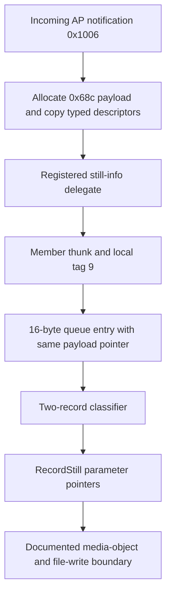

# Still-info notification to saved-image descriptors

The AP side now has a concrete static chain from **incoming notification `0x1006`** to the descriptor payload consumed by `mpr::RecordStill`. The same allocated outer payload pointer survives its callback and local queue; the descriptor bytes and pointer grouping can be reproduced with original instruction slices. The missing edge is earlier: this pass does **not** identify who produces notification `0x1006`, or prove that a particular JPEG/HEIF encoder response produces it.

No camera, USB connection, network, installer or firmware writer was used. No image was encoded or saved. This is ordinary offline ELF/Capstone evidence and isolated host emulation; **no new native REA session or REA Evidence is claimed**. Earlier native REA results for the file-side endpoint remain separately documented in [STILL_SINK.md](STILL_SINK.md).

## Reproduction and source identity

[trace_encoder_save_link.py](trace_encoder_save_link.py) verifies the original A7C II 2.01 `appFw.so` SHA-256 `2ea02f7ecbc5bb917316fe8ef4ce5ffd87eb66efaae78ba2ce11420552df539b`. [encoder-save-link.json](evidence/encoder-save-link.json) retains **20 ranges / 1,063 AArch64 instructions**, source/file coordinates, individual byte hashes, relocations, switch data, selected direct callsites and **18 host dataflow cases**. Each range states whether it is a complete entry or a selected prefix/block; this is not whole-program coverage.

```sh
.venv-research/bin/python research/trace_encoder_save_link.py
```

All addresses below are original `appFw.so` ELF virtual addresses. File offsets are mapped through `PT_LOAD`; a Ghidra shared-library address would add `0x100000`. The synthetic addresses in host test output are arbitrary host-emulator memory addresses, not camera addresses.

## Incoming notification becomes a typed recording payload

The AP message worker begins at `0x35314fc`. It receives from OSAL destination `0x80020002` and checks source IDs `0x90030001`, `0x90040193`, `0x8102021f` and `0x90bf0274`. This source gate is not proof that the selected case uniquely originates from CP. The dispatch reads a halfword at message `+2`; comparison at `0x3531710..0x3531718` selects command `0x1006` and branches to `0x3533200`.

That case allocates an outer payload of **`0x68c` bytes**, then converts two wire union records, at message `+0xb8` and `+0x218`, into the two `0x2fc`-spaced recording records previously observed by the queue consumer. These are descriptor records, not full image buffers.

| Wire type at union `+0` | Queued type | Format | Bytes copied from union `+0x10` | Descriptor offset in each queued record | Auxiliary word copied from union `+0xc` to queued record |
|---:|---:|---|---:|---|---|
| 1 | 0 | JPEG | `0xc0` | `+0xc` | `+4` |
| 2 | 2 | RAW | `0x150` | `+0xcc` | `+8` |
| 4 | 1 | HEIF | `0xe0` | `+0x21c` | `+4` |

The wire records are spaced `0x160` bytes. Signed-byte switch data at `0x4c7d070`, relative to branch base `0x35332ac`, resolves the conversion without relying on decompiled types or class names. Wire type 0 selects another local tag, type 3 skips the typed copy, and values above 4 take the bound-check branch; this report does not assign those cases JPEG/RAW/HEIF semantics.

The same case also copies **`0x90` auxiliary bytes from message `+0x24` to payload `+0x5f8`**, and a word from message `+0xc` to payload `+0x688`. A `memcpy` of a descriptor preserves its embedded handles, addresses and lengths as bytes. It does not establish the meaning, ownership or validity of those referenced image buffers.

## The callback preserves the outer payload pointer

Registration at `0x352f510` is identified by the assertion diagnostic `infra_wrapper_imaging::detail::register_cb_still_info(i_infra_wrapper_cb_delegate*)`. It stores the delegate pointer in global cell **`0x9116610`** under a local synchronization helper. The selected worker case reads that cell and invokes virtual slot zero at `0x3533320`, passing the allocated payload as argument 1. If there is no registered delegate, `0x3533390` releases the payload through the allocator's deallocation wrapper instead.

The callback's implementation is resolved through constructor instructions and relocations:

| Evidence | Relationship |
|---|---|
| Constructor `0x3368c98`, stores at `0x3368dbc..0x3368dc8` | A callback subobject at owner `+0x180` receives the owner pointer, member function and zero adjustment |
| GOT `0x5b53b28` | Relative relocation resolves its member function to `0x34a9f7c` |
| GOT `0x5b9c200` | Relative relocation resolves the common callback table to `0x5b37ae8`; constructor adds `0x10` for the vptr |
| Table entry `0x5b37af8` | Relative relocation resolves virtual slot zero to member thunk `0x310572c` |
| Table entry `0x5b37b00` | Relative relocation resolves slot `+8` to setter `0x3105780` |
| Registration use `0x349e894..0x349e898` | Passes owner `+0x180` to registration adapter `0x34d2278` |

The adapter installs a diagnostic preprocessing callback through slot `+8`, then calls the still-info registration function. The thunk at `0x310572c` preserves the payload in a saved register while optionally invoking that diagnostic callback, resolves the stored member pointer and owner adjustment, and tail-dispatches to the member function. Thus this is a resolved callback implementation, not an edge inferred from neighboring strings.

The member at `0x34a9f7c` has exactly three instructions: preserve incoming payload as argument 2, set argument 1 to **local tag 9**, and tail-branch to enqueue helper `0x34a9e4c`.

## Queue insertion and consumption use the same pointer

The enqueue helper creates a **16-byte entry** containing the tag at `+0` and the **same payload pointer** at `+8`. It calls deque push helper `0x34a9c94` and signals a condition variable. The push helper copies that entry; it does not deep-copy the `0x68c` outer payload or its referenced image buffers. Tag 9 takes the append branch outside the helper's separately gated tag range.

The queue dispatcher later reads those same entry fields at `0x34ae1ac..0x34ae1b4`. Its signed-halfword table at `0x4c5f418`, relative to branch base `0x34ae264`, maps local tag 9 to `0x34ae304`, which calls consumer `0x34acd48` at `0x34ae30c`. The allocated pointer becomes the consumer's payload argument directly. After the selected handler returns, the dispatcher calls deallocation wrapper `0x2dafe14` at `0x34ae27c`.

This establishes outer-payload lifetime across the normal callback/queue/consumer path. It does not establish lifetime or cancellation rules for buffers referenced by the copied JPEG/RAW/HEIF descriptors, nor success of deferred file writing.

## Descriptor identity through RecordStill

The consumer reads the two local result tags and selects descriptor addresses inside the same payload. It gathers like-format descriptors into J0/R0/H0 and J1/R1/H1 using independent per-format counters, then passes that input through wrapper `0x34d40c8` and adapter `0x357c9f0`. The adapter calls `mpr::RecordStill` at `0x357cbec`.

| `RecordStill` parameter field | Selected descriptor pointer |
|---|---|
| `+8`, `+0x10` | JPEG descriptor 0 and 1, when present |
| `+0x18`, `+0x20` | RAW descriptor 0 and 1, when present |
| `+0x28`, `+0x30` | HEIF descriptor 0 and 1, when present |
| Initial `+0x38` | Payload `+0x5f8` auxiliary-block pointer on this handler path |

The 0/1 suffix is per format, not a proven frame index. The adapter has mode-specific handling that can overwrite its initial auxiliary pointer; [STILL_SINK.md](STILL_SINK.md) records those qualifications and the subsequent media-object area lists, filesystem submission and completion queue.



This diagram contains static instruction, relocation and field-identity relationships. It is not a captured camera execution trace. Its first node is still an unresolved producer boundary.

## What the host checks establish

For every pair drawn from JPEG/RAW/HEIF, the checks execute the original notification transformation, callback member thunk, tag wrapper, queue fast push, classifier and parameter-pointer copy in synthetic memory. Each pair runs both with and without the diagnostic preprocessor, totaling **18 cases**. The original diagnostic wrapper also runs on the non-null branch; only its downstream logging helper is intercepted. `memcpy` is intercepted to copy synthetic memory. Every case verifies descriptor bytes, auxiliary words/block, unchanged outer-payload pointer, local types, per-format grouping and final `RecordStill` pointer positions.

These tests do not invoke OSAL receive, real locks, condition-variable notification, allocation, callback registration, media encoding or filesystem operations. They are evidence about the selected instructions and field identities, not tests of a usable camera API or firmware patch.

## Remaining encoder-to-notification edge

The [CP JPEG response investigation](STILL_ENCODER_ROUTE.md) has a result scalar transported through a response header; the code here instead receives a still-info notification containing two typed descriptor unions. No instruction or shared object identity found in this bounded pass equates those objects. The exact producer of `0x1006`, the code that populates its JPEG stream handle/length and HEIF grid areas, and correlation with encoder completion remain unresolved.

That producer is the next decisive target. Closing it requires matching the actual encoded-buffer handles, offsets, lengths and dimensions into these union descriptors, including completion and buffer ownership. This notification-to-recording result does not by itself connect MLUT output to the still encoder or establish a safe custom-program interface.
