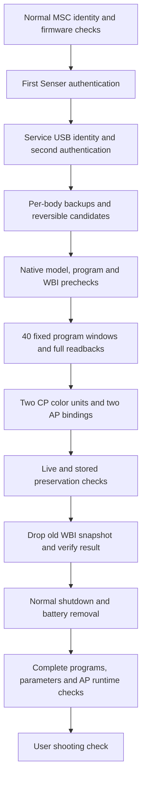

# Mac installation findings and lessons

On October 18, 2026, local revision `0.1.1-preview` was installed on one ILCE-7CM2 running firmware 2.01. Complete AP/CP program readbacks, target parameters, WBI completion and all six AP runtime regions after battery removal passed verification. The user reported FL2/FL3 visible and basic capture working with FL1, FL2, FL3 and Auto. Final normal USB return timed out after successful service exit; the truthful final phase remains `verified_after_cold_start_usb_unconfirmed`.

Use [MACOS.md](../MACOS.md) for operating instructions and failure classification. This case study explains the implementation, evidence and recovery decisions. [The sanitized trial record](evidence/macos-installation-review.json) and [VALIDATION.json](../VALIDATION.json) state the current result; original programs, settings, serial-derived identity, crash reports and raw USB/runtime logs remain private.

## Tested configuration

| Component | Configuration in this trial |
|---|---|
| Camera | One Sony ILCE-7CM2; normal protocol query reported 2.01 and complete original files matched the supported fingerprints |
| Host | Apple M3 Max, arm64, macOS 27.0.1 build 26A434 |
| Python | 3.14.6 in the adapter's project-local virtual environment |
| USB dependencies | PyUSB 1.3.1; libusb-package 1.0.30.0; bundled native libusb 1.0.30.12037 |
| Other dependencies | pycryptodomex 3.24.1, PyYAML 6.0.3, importlib_resources 7.1.0 |
| Mac adapter | MDHan commit `d9eac5a3f805a65a894722d9a4b8800ac6b8df15`, checked by [the local lock](toolchains/macos-adapter.json) |
| Payload | This repository's fixed `0.1.1-preview` app/core/transport and [deployment manifest](../assets/manifest.json) |
| Finish implementation | Unchanged MDHan `macfl23/finish.py` from `b625c78f43eca9208e6c00f564cebbf353031891`, SHA-256 `2c3a1a8762d0ab61115835e1932032b492a56d31d7989222e8caf21af836a8b0` |
| Features | FL2/FL3 only; no optional NTSC-notice change |

These versions describe one observed configuration, not a minimum or universal compatibility claim. Upstream's earlier successful installation used a body-specific script; its generic adapter had a narrower validation history. Our combination also introduced a local module-provider seam and USB discovery changes. It was not the unchanged upstream installer running out of the box.

The original upstream release downloaded by the adapter remained checksum verified and unchanged. `engine.load` selected the separately validated local modules. The adapter and finish implementation were pinned separately; updating an upstream checkout or invoking its CLI directly would select a different workflow or payload.

## How the port operates



Normal USB identity is `054c:0e8a`; service identity is `054c:0336`. Both authentication stages matter. The normal stage checks model and serial-derived identity before the transition. Service entry then verifies the physical USB port, interface ownership and 88-byte ProductInfo response.

The AP Linux process loads a fixed native shared object through the Jiritsu `libJit.so` entry. The probe's native report verifies effective UID 0. Restricted workers then inspect or modify specifically permitted files and settings. This demonstrates privileged temporary execution through this service path on the supported firmware. It does not install a persistent root shell, SSH service, general app launcher or universal firmware-signing bypass.

The AP file `/usr/lib/appFw.so` supplies the relevant menu/binding and metadata changes. The CP file `/cp/cpapp-b.bin` supplies processing dispatch, gamma and related changes. Two CP color units receive records merged into this body's own data, and two AP bindings select the added looks. See [the implementation](../README.md#implementation-ap-cp-and-native-parameters) and [the three preceding fixes](FIXES.md). This native Creative Look port does not add arbitrary `.cube` import for still photos; [the saved-still LUT path remains a separate research problem](STILL_LUT_FEASIBILITY.md).

## What completed and where the interruptions occurred

| Stage | Observed result | Consequence |
|---|---|---|
| Early entry attempts | First authentication completed; the process timed out waiting for `0336` | No backups/modules or firmware/settings writes had begun in those attempts |
| Service ownership | `lghub_agent` owned a user client under the Sony vendor interface | Original driver guard stopped entry; no guard was bypassed |
| Preparation | Eight backups, complete candidate/reverse checks and probe/installer0/WBI0 passed; service exit and MSC return were logged | Host crashed afterward during USB object destruction; saved evidence required independent review |
| Initial install entry | Timed out before the installation with-body | Saved `needs_review / install / prepared`; no install writes |
| Reviewed continuation | Rechecked originals and native prerequisites; installer1 completed 40 windows; complete program readbacks matched | CP units and AP bindings were written/read back/saved; preservation stopped at the live `+60` difference |
| Offline settings review | Expected targets, attributes and reset bytes matched, with two explicitly accounted observations described below | Did not authorize reinstallation or silently advance the failed phase |
| First finish entry | Same `0336` discovery timeout; no WBI write attempted | Source state unchanged; no WBI-attempt marker |
| Existing-service continuation | Authenticated the observed service object; complete current guards passed; WBI0 and WBI1 reports verified | Only normal USB return timed out; installation body completed |
| Cold-start verification | User confirmed battery removal; complete programs, parameters and all six AP memory/disk windows matched | `verified_after_cold_start_usb_unconfirmed`; no further install/WBI operations needed |
| Manual use | User reported photos with FL1, FL2, FL3 and Auto seem to work | Basic capture report only; separate playback, format and image analysis were not confirmed |

## USB discovery and ownership

### A timeout does not identify the failed layer

The normal-to-service transition failed intermittently even with a 60-second wait. Later OS inventory and a new Python process could see `0336` on the same physical port. This does not establish whether arrival was delayed, an event was missed, or process/resource lifetime affected discovery.

PyUSB caches its normal libusb backend. The local wrapper creates a fresh backend context per polling scan to request a new Darwin registry scan. It retains checks for exactly one matching device, the original bus/port and a readable configuration. This helped several real entries but did not eliminate the failure. A longer timeout and fresh contexts are mitigations, not a demonstrated root-cause fix.

An independent authentication-only trace recorded both the utility and OS view. It saw the service device arrive, successful second authentication, then service-device removal after the exit request. The OS itself saw no supported camera identity during that run's normal-return wait. That specific return timeout was not merely a stale libusb device list. Entry failures without a concurrent OS trace cannot inherit the same explanation.

### G HUB held the interface

IORegistry showed an `AppleUSBHostInterfaceUserClient` created by `lghub_agent` under the service interface. The reported unexpected driver was therefore a real ownership conflict, not a reason to delete the guard.

Stopping the agent alone let the G HUB parent restart it. Temporarily closing the user-level tray/UI and agent removed the interface client. The updater daemon remained running. No Logitech settings or launch configuration changed; G HUB was reopened after USB operations ended. Future handling should identify the actual owning client instead of killing unrelated applications, disabling SIP or changing global USB drivers.

### Host context lifetime caused a real crash

The first fresh-context implementation introduced a host SIGSEGV after preparation. PyUSB normally relies on its global backend staying alive. With an independently owned context, its resource manager could release the backend before releasing the raw `_Device`; the later `libusb_unref_device` then used a dead context. The crash trace reached device destruction through ctypes/Python deallocation.

The fix in [owned_context_backend](../macos_fl23.py) retains the backend on every enumerated raw device and on parent-device references. Enumeration lists are finalized while the context is still alive. The context can be destroyed only after the last raw device reference is released. [The lifetime test](../tests/test_macos_profile.py) checks that order with garbage collection; a separate host stress run completed 32 enumeration/parent/cleanup cycles without interface claims or authentication.

The crash was introduced by the local host change; it was not a camera crash. A host exit code of 139 did not by itself establish the preparation outcome. The saved phase, all eight backup hashes, candidate/reverse checks, raw native reports and exit journal were independently reviewed before proceeding.

## Settings preservation required two distinct explanations

The fixed settings workflow snapshots live and stored views independently, rejects unrelated pending edits in any subsystem it will save, and compares data, attributes and reset bytes afterward. Comparing later storage against earlier live memory would lose that distinction. [core.py](../core.py) still rejects unexplained changes; its global runtime-counter rules were not widened.

### The live property increased by exactly 60

At the preservation stop, AP key `0x02770015` had four data bytes, attribute 2, unchanged reset data and an unsigned little-endian increase of exactly 60. The independently captured stored view did not change at that key. Its meaning is not decoded, and the observation does not prove it is a generally ignorable counter.

The historical review admitted this exact live difference only for the pinned failed-state/evidence set. Stored preservation used the separate stored-before snapshot and did not receive that exception. A different delta, attribute, length or reset value was rejected. This is why finish-only recovery was reviewed separately instead of removing the original failure check.

### A reported reset byte belonged to the FL3 binding

The vendor backup parser reads 13 reset bytes for array property `0x02cf1288`. In these snapshots that read overlaps the neighboring `0x02cf1289` data:

```text
array data starts at P; size = maxSize = 13; attribute = 0xc0
parser reset read starts at P + 13
parser reset byte 1 is at P + 14
FL3 binding data byte 0 is also at P + 14; attribute = 0x60
```

The observed change was the same physical byte changing from 0 to the intended FL3 binding value 11. Property pointers, sizes and attributes matched between snapshots; actual array data and every other reported reset byte were unchanged. This proves the duplicate read in this case, not a complete corrected decoder for every Sony array property.

[settings_snapshot_review.py](settings_snapshot_review.py) requires that pointer relationship, exact key/type/length, expected owner value and unchanged remaining bytes before accounting for the duplicate. It then runs the normal preservation comparison. Tests reject changed pointer relationships, unrelated reset bytes, target reset data, attributes, other properties and non-60 deltas. The original snapshots and the core parser are not modified.

The reviewed result preserved 53,239 unrelated live properties and 53,241 unrelated stored properties, including attributes/reset bytes, after accounting for the intended four targets, the existing two live runtime allowances and the narrowly scoped observations above. Those counts describe this body, not a universal backup schema.

## Recovery was based on evidence rather than phase edits

The pre-body continuation required exact source-state and raw-precheck report hashes, complete backup/candidate validation and proof that the earlier install body never ran. It preserved the failed state as evidence and used a distinct rechecking phase. In the same identity-bound session it reread the full originals and reran native prerequisites before calling the shared installation body. Normal `install` still rejects `needs_review`.

The later finish-only path required explicit informed user opt-in, as required by [upstream's rules at b625c78](https://github.com/MDHan/a7c2-fl23-macos/blob/b625c78f43eca9208e6c00f564cebbf353031891/AGENTS.md). Its local historical review was stricter about reset data and separate stored baselines than the upstream finish reviewer. Fresh checks required:

1. Complete AP/CP files matching the fixed candidate fingerprints.
2. All four direct, live and saved targets and their attributes matching the expected values.
3. Preservation of the current saved-property snapshot against the reviewed saved-after baseline.
4. All six AP disk windows matching the candidate. Memory could match the candidate, or the exact original bytes only for the two known menu windows.
5. Expected WBI backend and image mode, followed by a successful WBI mode 0 precheck.

The guarded finish session exposed only approved reads, the exact temporary runtime reader and fixed WBI workers. It exposed no program installer, CP/AP parameter write or parameter-save operation. A `finish-attempt.private.json` marker and `finishing_snapshot` phase were saved before WBI mutation. An unknown write result would preserve the marker and block another attempt.

When the first finish timed out before entry, the native write marker did not exist. A later continuation used the already-observed service connection after the user confirmed unchanged USB/power. It checked the same IORegistry object, physical port and service interface before second authentication. That identity binding relied on the immediately preceding normal identity check plus confirmed connection continuity; it was not a fresh serial read in service mode. Recreated registry objects, normal mode, a different port or another interface owner were rejected.

These case-bound helpers remain in ignored local build storage because they contain private paths and body/session-specific guards. Their names are not supported public CLI actions. Do not generalize them by copying another body's state, changing fingerprints or deleting attempt markers. The documented contract preserves the useful design without publishing a broadly callable force-resume switch.

## WBI completion and cold start solve different parts

WBI is the camera's boot-snapshot mechanism in this path. Verified disk writes alone did not update two menu tables held in the AP process. Before battery removal, four AP memory windows matched the new candidate and the two menu windows matched the exact original. All six disk windows already matched the candidate.

The fixed [WBI worker](../native/wbi.c) required `image_mode=2` and backend `*wbi4`, wrote ASCII `1` to `image_drop`, then ASCII `0` to `image_mode`. It checked one-byte writes, close results, mode 0, unchanged backend and a fresh drop-log marker. Raw mode 0 and mode 1 reports passed [core parsing](../core.py) independently. This operated through vendor sysfs interfaces, not raw block writes.

After the user confirmed normal shutdown, battery removal for about ten seconds and power-on, both menu windows and all four other AP windows matched the candidate in memory and on disk:

| AP file offset | Bytes | Before full cold start | After full cold start |
|---|---:|---|---|
| `0x3528804` | 112 | Candidate | Candidate |
| `0x4b2ed19` | 2 | Candidate | Candidate |
| `0x59892b8` | 40 | Exact original menu bytes | Candidate |
| `0x5989370` | 40 | Exact original menu bytes | Candidate |
| `0x4b4a5e4` | 12 | Candidate | Candidate |
| `0x4b3b544` | 12 | Candidate | Candidate |

The post-start report showed image mode 2 again. WBI completion had verified mode 0 before shutdown; the later observation does not invalidate those raw results or justify another WBI write. The six AP matches, full program hashes, target parameters and visible menus establish the result we needed. They do not directly inspect executing CP instructions or measure output color accuracy.

## Evidence that should survive a failed operation

Keep the original backup files, candidate files, full program readbacks, live/stored before/after snapshots, raw native reports, state journal, exit report and process exit code. Native result modes distinguish installer0 from installer1 and WBI0 from WBI1. A completed report and an intended operation are different evidence.

The Mac preparation saved eight original files: live and stored settings, both full programs, two CP color units and two AP bindings. Each was hash checked. Default Mac preparation stored one original copy; the standalone `backup_camera.py` workflow's separate two-copy policy is a different workflow. These facts must not be merged in documentation.

| Private original filename | Purpose |
|---|---|
| `backup.private.bin` | Complete live settings snapshot |
| `backup-stored.private.bin` | Independent complete stored settings snapshot |
| `appFw.so.bin` | Complete original AP program |
| `cpapp-b.bin.bin` | Complete original CP program; the doubled suffix is the actual backup naming convention |
| `unit-02a40001.bin` | This body's original CP chroma/color unit |
| `unit-02a4000d.bin` | This body's original CP matrix unit |
| `ap-02cf1287.bin` | Original first reserved AP binding |
| `ap-02cf1289.bin` | Original second reserved AP binding |

Private paths, serial hashes, calibration/settings bytes, original firmware and raw crash/USB logs do not belong in public evidence. Public reports should retain common payload hashes, counts, booleans, proof conditions and validation scope. Root-owned files after an interrupted host process need narrowly scoped local ownership repair, not deletion, rerunning the camera action or changing global permissions.

## Validation provenance

| Check | Observed coverage | Scope |
|---|---:|---|
| Root host suite | 41 tests | Rerun for this documentation pass; [public log](evidence/offline-tests-macos-documentation.log), no real USB operations |
| Pinned adapter suite | 48 tests | Earlier unchanged-adapter checkpoint during installation preparation; mocked camera/session behavior |
| Adapter host/session/workflow with local provider | 25 tests | Earlier integration checkpoint, including after installation-body extraction and lifetime fix |
| Raw-device context stress | 32 cycles | Host enumeration, parents and garbage collection; no interface claims, authentication or camera writes |
| Pre-body continuation simulation | 6 cases | Entry/original/probe/precheck failure gates and normal/exit-timeout completion |
| Applicable upstream finish tests | 5 tests | Historical review, write restriction, runtime gates and distinct completion/failure outcomes; upstream CLI test excluded because our pinned CLI predates that action |
| Local finish guards | Separate synthetic checks | Explicit opt-in, unchanged saved-view acceptance and unrelated saved reset-data rejection before WBI |
| Existing-service continuation | 7 cases plus 3 registry mutations | Identity/object/port/owner/authentication/ProductInfo gates; no real camera commands |

The [CP/AP offline revision checks](FIXES.md#offline-results) retain their own dated reports. None of these synthetic counts establishes a generally reliable USB transition or full photographic coverage. The hardware result comes from native reports, full readbacks, post-cold-start AP memory comparison and the separately labeled user report.

The [documentation check receipt](evidence/macos-documentation-checks.json) records local link/anchor checks, shell-example syntax, unchanged deployment fingerprints, license/source provenance and evidence consistency. This refinement pass sent no camera commands and changed no private camera state.

From the repository root, these checks validate the current host suite and pinned payload without touching a camera:

```sh
research/build/a7c2-fl23-macos/.venv/bin/python -B -m unittest discover -s tests -v
research/build/a7c2-fl23-macos/.venv/bin/python -B macos_fl23.py check
```

## What to improve before another installation

| Priority | Remaining work | Evidence needed |
|---|---|---|
| High | Diagnose intermittent Mac handoff/discovery | Concurrent OS/libusb timing and controlled host-lifetime experiments before more write trials; do not call fresh scans a complete fix |
| High | Decode array/reset layout correctly | Independent Sony format/handler evidence and synthetic cases beyond the one proven overlap |
| High | Determine `0x02770015` semantics | Scoped read-only observations and native references; no global counter allowance from one delta |
| High | Design a reusable recovery workflow | Explicit pre-write/post-write classification, immutable evidence, current identity binding and one-shot mutation guards, with synthetic failure tests |
| Medium | Validate photographic coverage | New files, explicit playback, JPEG/HEIF/RAW and bursts, default/reset/import behavior, metadata and fixed-scene color comparisons |
| Medium | Validate CP behavior on hardware | Evidence beyond CP file hashes and AP runtime windows, including transitions to movies and the corrected fallback |
| Medium | Improve operator feedback | State the current phase, whether any write started, whether the body completed and what physical action is justified; avoid repeated opaque helper commands |

The completed installation is a working baseline for further offline LUT research. No arbitrary still-photo LUT support, persistent custom-program environment, general damaged-image recovery or second-body reliability follows from it.
