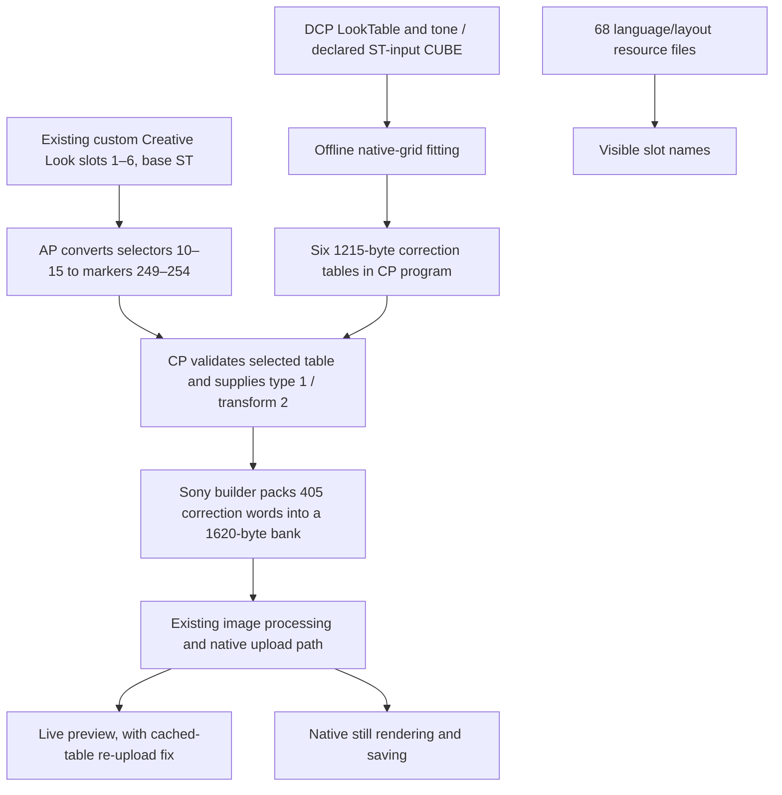

# How the reference project implements native Fuji-style looks

Reviewed on October 20, 2026, from the already downloaded
[QAQLeonard snapshot](https://github.com/QAQLeonard/a7c2-fl23-research/tree/c046013c53883cd6f0fe660a9f5fec7a48d94722),
commit `c046013c53883cd6f0fe660a9f5fec7a48d94722`. This review used local files;
it did not fetch a newer revision, enumerate devices, access the camera/card,
touch G HUB or invoke Apple developer tools. No installation was prepared.

**The useful result is native, selectable film-style color in Sony's existing
processing pipeline.** The project converts a DCP look or a CUBE into a small
Sony correction grid, then patches the Creative Look selector and CP table
selection. It does not require our completed-JPEG/HIF worker or the unresolved
MLUT allocation-to-encoder link. It also does not implement a complete Fujifilm
renderer or establish exact Fujifilm color matching.

## The complete route



The native still output and preview observations are reported by the author
on one body; this diagram does not claim every image format was tested.

## 1. Film source and color conversion

The reference release describes **11 MTriton Fuji-style DCPs** plus seven
Ricoh-style DCPs. Its Fuji sources are third-party Sony-adapted RAW profiles,
not a transplant of Fujifilm firmware. Source attribution and profile hashes
are in its [profile manifest](https://github.com/QAQLeonard/a7c2-fl23-research/blob/c046013c53883cd6f0fe660a9f5fec7a48d94722/docs/profiles/manifest.json).

For DCPs, `references.DcpLook` reads the HSV LookTable, its value-axis encoding
and a tone curve. It deliberately excludes donor sensor matrices and camera
HueSat calibration. `calibration.inverse_st` approximates a Sony ST value's
linear ProPhoto/D50 input using a monotone inverse curve and a 3×3 matrix.
The extracted look and hue-preserving tone spline are then evaluated and
converted to an sRGB target. The bundled exposure convention is a reference
rendering parameter, not a camera exposure-setting write.

For CUBEs, the declared direct input is Sony ST sRGB and output is sRGB.
Other inputs require a supplied ST-to-input bridge. Relabeling a Log LUT is
insufficient. The supported input is a standalone 3D CUBE, not CLF or a
combined shaper/3D file.

The native fitter does **not** retain the original high-resolution LUT. It
solves for 405 triplets on a 5×9×9 grid using trilinear weights, a supplied ISP
response matrix, smoothness regularization and bounded integer coefficients.
Its coordinate hypothesis is BT.601 limited-range Y/chroma. Values are limited
to **−64…63**, rounded, and serialized into three 405-byte planes. The predictor
models output as input RGB plus interpolated correction / 256 through the
response matrix, followed by clipping. Synthetic held-out RGB error measures
fit to that model, not the camera's color accuracy.

The shared model explicitly says it was estimated from **one A7C II RAW/ST
scene and native response trials**, and sets
`full_camera_characterization=false`. It omits the complete Adobe RAW renderer.
No multi-scene chart measurements or independent Fuji-body equivalence are
established by the reviewed source. Spatial holdout from one scene is not an
independent-scene test.

A pointwise color-correction grid cannot by itself reproduce spatial grain,
another sensor/demosaicer, or scene-dependent exposure/dynamic-range behavior.
Those mechanisms are not implemented by this table conversion. Eleven source
profiles do not mean eleven simultaneous native slots: this implementation
provides six custom slots, whose tables can be replaced later.

## 2. Existing slots and AP firmware

The six custom Creative Look slots already exist. The patch binds imported
ones to Sony **ST** and uses their selectors 10–15 to emit reserved markers
249–254. This is separate from the ordinary FL/FL2/FL3 values 15/19/20.

The standalone AP implementation at `0x35287f0…0x3528874` uses a six-bit mask:
only imported slots with base ST receive custom markers. Unselected slots
keep the original base conversion and dynamic title getter. Special selector
16 remains the original special value. A title-entry branch at `0x1b5cd7c`
selects resource IDs `0x0200ab2c…0x0200ab31` for imported slots. The historical
six-look layout uses a different ordering of the first two name IDs; adapters
must distinguish those layouts.

Names are separate transactions over 68 language/layout resource files.
Writing a table does not write a menu name. Saved and live slot recipes also
need separate provisioning and checks. ST is a required binding, **not a hard
menu lock**: the user can still edit a slot's base. Neither selector conversion
nor title replacement proves that Creative Looks become selectable in AUTO.

## 3. CP firmware and native hardware banks

The reference six-table layout uses CP file offset `0x8000` / VA `0x110000`:
a 32-byte magic/version/checksum header, followed by six 1215-byte tables.
The total is 7,322 bytes. Each table has an FNV-1a32 corruption check.

The Thumb helper, associated with CP file `0xb27490`, recognizes markers
249–254, checks context/availability and table integrity, then supplies the
selected pointer with **source type 1, transform 2** to the native table
builder. Gamma conversion treats those markers as ST. Invalid cases retain
the legacy path. These context fields are not evidence for AUTO mode or
universal photo/video meanings.

The **stock** A7C II 2.01 builder at VA `0x23dc2c` already knows how to pack
these corrections. There are 405 32-bit words (1,620 bytes). For each native
permutation index, the three seven-bit fields occupy bits 22–28, 12–18 and
2–8. The permutation at VA `0xec7c20` is a bijection over 0…404. Raw plane
bytes must not be copied directly into the packed bank. Seven-bit correction
coefficients do not imply that the whole photo or a HIF output is seven-bit.

This route is distinct from the larger imported MLUT payload documented in
[NATIVE_LUT_FORMAT.md](NATIVE_LUT_FORMAT.md). Recovering that MLUT's pixel
allocation lineage was unnecessary for this particular native-look approach.

## 4. Why preview required extra work

The author reported correct photos while live view intermittently retained
the previous look. Their v4 fix reuses native VA `0x23d56c` to mark a validated
cached table for upload, rather than rebuilding its color data. The native
uploader at `0x42cd28` observes the upload flag and reaches the bank-copy path
at `0x78aa20`.

The published controlled model skips an upload submission and demonstrates
recovery by retrying. It is not a real scheduling trace. Repeated eligible
updates can cause repeated uploads: the documented ten-update case changes
from one upload to ten, with one build in each case. Performance, power and
thermal cost remain to be measured. A repaired incoming wide-branch boundary
must also be retained. Earlier UI/segment experiments caused restart loops;
the abandoned approach is not part of a safe port plan.

## 5. What is actually demonstrated

The author's [validation record](https://github.com/QAQLeonard/a7c2-fl23-research/blob/c046013c53883cd6f0fe660a9f5fec7a48d94722/docs/en/technical/validation.md)
reports an existing six-look installation, working photo/preview observations,
and later GR Positive slot-5 and Astia slot-4 updates on one Windows-connected
camera. Complete program/resource readbacks, loaded AP spans and recipes were
checked; running CP RAM was not directly dumped. Stock first-install, physical
Mac installation/restoration and RAW/HEIF/burst/video regressions remain open.
These are upstream reports, not additional tests on our body.

Our new [offline checks](check_native_looks.py) independently execute the
published AP templates and the original unpatched CP builder using synthetic
memory. [The receipt](evidence/native-looks-checks.json) records:

- 3,520 selector cases covering all 64 import masks, ST/non-ST bases,
  special/native selectors and an invalid-binding exit.
- 120 stock-CP bank cases covering five signed patterns, levels 0/1/7/8,
  direct/cached destinations and three bank indices, with exact 1,620-byte
  equality to an independent packer and restored return/stack.
- Hashes of the reviewed fitting, calibration, adapter and format sources.

Separately, all **17 upstream `test_toolkit.py` numerical/parser tests passed**
locally using the existing Anaconda NumPy/SciPy runtime. Those tests use
synthetic fixtures. No device CLI, USB import, compiler, firmware patch or
physical preview test ran. The new CP tests do not execute the custom CP helper
or uploader and do not establish pixel-level color accuracy.

Reproduce without invoking Apple developer tools:

```sh
.venv-research/bin/python research/check_native_looks.py
PYTHONPATH=research/build/qaqleonard-reference-20261020/src/looks \
  /opt/anaconda3/bin/python -m unittest discover \
  -s research/build/qaqleonard-reference-20261020/src/looks/tests \
  -p test_toolkit.py -v
```

## Consequence for our next implementation

**Evaluate one native correction-table candidate before choosing this route.**
The [Astia experiment](ASTIA_NATIVE_CANDIDATE.md) now measures substantial
model fitting loss and verifies bounded FL23 composition behavior, while HIF
and physical activation remain unresolved. The completed-photo worker remains
useful for larger transforms, manual-lens EXIF and external workflows.

| User priority | What this implementation contributes | What is still needed |
|---|---|---|
| Creative Looks in AUTO | Reuses existing custom slots | Trace AUTO's availability/selection policy separately; no AUTO unlock is proved |
| Imported Fuji looks | Six selectable native ST-based tables with names | Adapt/fit the chosen sources, measure residuals and audit compatibility with our exact FL23 programs |
| JPEG and 10-bit HIF | Uses native image processing, avoiding worker re-encoding for color | Confirm the custom correction stage is active on HIF, its color domain and saved output; upstream HIF regression remains open |
| Manual-lens EXIF / printing | No implementation in this native-look path | Keep the separate metadata/worker/printing research |

Our supplied **TingfengLuo XMP/RGBTable pack is a different input** from the
reference's MTriton DCPs. Our validated CLFs preserve the Adobe RGBTable stage;
the reference importer accepts neither XMP RGBTable nor CLF directly. We can
reuse our evaluated transform as a fitting target, but must establish its
Sony-ST input contract and explicitly measure the new 405-node/7-bit fitting
loss. A scene-referred native fit additionally needs a defensible inverse-ST
bridge; the existing rendered-sRGB adaptation alone does not supply one.

The next concrete offline deliverable should be a selected native-look
candidate with source provenance, neutral/skin/saturated-color residuals,
coefficient saturation counts and a reviewed conflict report against our
FL23 program windows. Do not combine it with AUTO changes or an installation.
The reference installer cannot be assumed to recognize our revised FL23
source identities. No candidate from this review is ready to flash.
