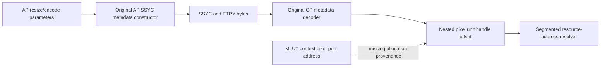

# SDYC is a metadata buffer containing a second pixel descriptor

The JPEG input descriptor and the pixel-buffer descriptor are **two separate layers**. The AP constructs an `SSYC` metadata buffer; the CP resolves that outer buffer, reads its image-size entry, then resolves the pixel unit/handle/offset embedded inside. Comparing the JPEG input handle directly with an MLUT pixel address would skip the second layer.

This pass executes original AP metadata construction and original linked dataflow-library functions in a bounded host emulator. The [CP mapping follow-up](SDYC_MAPPING.md) independently decodes the four resulting fixtures through original CP instructions. Both sides agree on the nested descriptor and geometry. Physical resource-service results are synthetic; no pixel, camera memory, codec or camera process is accessed.

## Reproduction and evidence

Run `.venv-research/bin/python research/trace_sdyc_metadata.py` from the repository root. The [evidence](evidence/sdyc-metadata.json) pins both original input ELFs, the generator, **11 instruction regions / 803 instructions**, four cases and the exact 1,024-byte metadata fixtures. Sources are the already downloaded official ILCE-7CM2 2.01 `libInfraAvbbc.so` and `dataflowInfraFramework.so`. These host results are ordinary offline evidence. Separately retained native REA corroborates the [serializer](evidence/rea/readable/sdyc-entry-serializer-01-procedure_pseudo_code.c) and [physical-mapping constructor](evidence/rea/readable/sdyc-physical-map-00-procedure_pseudo_code.c).

Only locally defined ELF symbol bindings are modeled. The libraries are mapped into separate synthetic address ranges, their local data relocations are applied, and their PLT calls dispatch to original local code. The physical-mapping constructor/destructor and diagnostic printer are intercepted; the aspect helper returns the explicitly synthetic value 1. Host `memcpy`, `memset` and bounded `strncmp` stand in for libc. Unknown externals abort rather than reaching host services. No syscall forwarding is present.

## The AP constructs a metadata buffer, not an image

Original `ExecCmd_SDF_EncodeJpegMain::MakeInputYcStdData` at ELF VA `0x1218a8` receives the resize/encode parameter payload. Its inputs distinguish the outer metadata allocation from the pixels:

| Parameter payload field | Proven use |
|---|---|
| u64 `+0x18` plus u64 `+0x20` | Address supplied to `AvbbcPhycMem`, mapping size `0x400` |
| u32 `+0x30/+0x34` | Nested image-size record's unit type and unit handle |
| Low u32 of u64 `+0x48` | Nested image-size record's unit data offset |
| u16 `+0x54/+0x56` | Image-size record geometry at serialized payload `+0x2e/+0x30` |
| `+0x58..+0x5e`, `+0x60..+0x63` | Additional size/state fields copied or converted by the retained original code |

The method clears the first 32 metadata bytes, constructs image-size, YC-state and image-output-timing entries, and installs them through the original `C_DataflowInfra_StdData_YC` API. The [AP encoder-command trace](AVBBC_ENCODER_BRIDGE.md) separately shows the **outer** JPEG command descriptor coming from parameter `+8/+c/+0x20`. Those descriptor words must not be confused with the **nested pixel** fields `+0x30/+0x34/+0x48`.

The physical constructor at `0x1401a8` statically requests the page size, opens `/dev/mem`, aligns the supplied address down, maps it and adds the intra-page displacement. This constructor is **not executed by the fixture generator**: the interceptor records its requested address and supplies host RAM. This static code does not establish privileges or a usable mapping on the connected camera.

## The serialized SSYC layout

All four original-code fixtures have header marker `SSYC`, serial 0, format version 1, entry count 3 and first entry offset `0x20`. Entry headers use marker `ETRY` and offsets relative to the metadata base:

| Category | Entry header | Entry data | Reserved data extent | Next entry |
|---:|---:|---:|---:|---:|
| 0: image-size information | `0x20` | `0x40` | `0x60` | `0xa0` |
| 1: YC state | `0xa0` | `0xc0` | `0x20` | `0xe0` |
| 2: output timing | `0xe0` | `0x100` | `0x40` | 0 |

The nested pixel descriptor appears in category-0 data at **`+0/+4/+0x18`**. Its separate physical-address field at `+8` is zero on this builder path. Original named accessors and stores distinguish `UnitHandle`, `UnitAddressPhy64` and `UnitDataOffset`; zeros in the physical-address field therefore do not imply an absent pixel allocation. Geometry is at data `+0x2e/+0x30`.

The serializer reserves aligned extents. It does not overwrite every reserved byte; the fixtures deliberately prefill the host metadata area with `0xa5` and retain those bytes. These are synthetic padding markers, not firmware data or evidence that uninitialized metadata causes a camera defect. Guard bytes immediately outside the requested 1,024-byte area remain unchanged in every case.

## What the cross-decoding closes

The four fixtures use distinct unit/handle/offset markers and supplied dimensions `7008×4672`, `1920×1080` and `640×480`. An independent Python field check verifies the three entry headers, nested descriptor, geometry, physical-address field and guards. More significantly, [the CP follow-up](SDYC_MAPPING.md) passes the actual AP-generated bytes through original CP metadata parsing and confirms the same descriptor and dimensions. Its resource-service fixtures then resolve the nested descriptor separately.

This closes an offline **AP-producer-to-CP-consumer metadata-format link**. It does not show that the production capture graph supplies the MLUT ring allocation to that nested descriptor, establish the pixel format/color domain, or prove a full-resolution image passes through MLUT before JPEG/HEIF encoding. The next missing allocation-provenance edge is more precise than a generic SDYC-format question.
