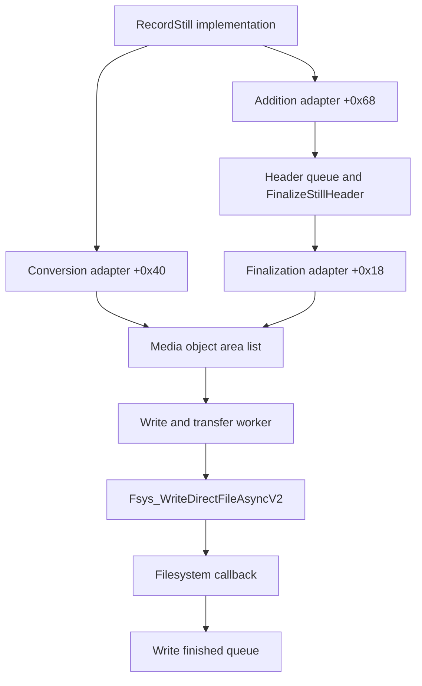

# AP still media objects to the file-write boundary

The unresolved virtual calls in the earlier [recording investigation](STILL_RECORDING_BOUNDARY.md) now have concrete JPEG, ARW and HEIF implementations. They assemble metadata/container regions and construct an area list consumed by the asynchronous filesystem writer. This establishes a useful **file-side endpoint**. It does **not** establish a full-resolution pixel buffer, an MLUT-to-encoder connection, or a safe place to apply a LUT to captured RGB data.

No camera was accessed or changed. The only instruction execution was isolated Unicorn emulation on the host with invented descriptors; neither media encoding nor filesystem writing was invoked. Addresses are original ELF virtual addresses, with the source library stated for the AP input section. Ghidra's shared-library addresses are these values **plus `0x100000`**, not camera runtime addresses.

## Source-bound method and reproduction

[trace_still_sink.py](trace_still_sink.py) verifies the original A7C II 2.01 `libmpr.so` SHA-256 `4fb6d886c1ac620399d09c9c2ffc074315968cf0ada764062913c4e0783fc7f9` and `appFw.so` SHA-256 `2ea02f7ecbc5bb917316fe8ef4ce5ffd87eb66efaae78ba2ce11420552df539b`. [still-sink.json](evidence/still-sink.json) contains 37 instruction ranges, 7,856 AArch64 instructions, individual range hashes, the three resolved vtables, selected direct callsites, nine resolved virtual edges and 95 host test cases. Every range identifies its `source_path`. Its extent field distinguishes exported function sizes from bounded prefixes, selected blocks and ranges ending at the next observed function entry.

This ordinary ELF/Capstone/Unicorn evidence is separate from **19 actual REA/Ghidra pseudocode Evidence records** under [still-sink-virtual-r2](evidence/rea/still-sink-virtual-r2/) and [still-sink-finalizers](evidence/rea/still-sink-finalizers/). Both sessions exported Evidence bundles and closed successfully; the mapper validates every query's firmware digest and the close receipts. The first attempted session failed before analysis because its shell lacked the local Ghidra/JDK configuration. Its diagnostic remains in ignored `research/build/still-sink-virtual-failed`; it contributes no successful native Evidence.

```sh
.venv-research/bin/python research/trace_still_sink.py
```

For native reruns, configure the [project-local REA toolchain](toolchains/README.md) and run the retained [virtual-method recipe](rea-jobs/still-sink-virtual.json) or [finalizers recipe](rea-jobs/still-sink-finalizers.json). The mapper can also generate either recipe into an ignored build file. Each recipe chooses an output directory under `research/build/rea-rerun`; change that directory before reusing a recipe.

```sh
.venv-research/bin/python research/trace_still_sink.py --rea-job virtual > research/build/still-sink-rerun.json
node research/run_rea.mjs research/build/still-sink-rerun.json
```

## Factory, relocations and virtual implementations

`stillutil::creater` at `0xc4de0` selects constructors by type 1, 2 or 4. Each constructor loads a GOT entry with an `R_AARCH64_RELATIVE` relocation, adds `0x10`, and stores the resulting vptr at object offset zero. Thus a virtual slot is measured from **table base + `0x10`**. Measuring slots from the table base would select the wrong methods.

| Factory type / class | Allocation | Constructor | GOT → table base | Object vptr | Virtual `+0x18` | Virtual `+0x40` | Virtual `+0x68` |
|---|---:|---|---|---|---|---|---|
| 1 / JPEG | `0x1558` | `0x26d090` | `0x2fd280` → `0x2fb7f0` | `0x2fb800` | `0x26e898` | `0x26f24c` | `0x26cd7c` |
| 2 / ARW | `0x14d8` | `0x267478` | `0x2fd678` → `0x2fb6d0` | `0x2fb6e0` | `0x268f5c` | `0x267148` | `0x267178` |
| 4 / HEIF | `0x1560` | `0x269fb0` | `0x2fd8e0` → `0x2fb760` | `0x2fb770` | `0x26a424` | `0x26ac20` | `0x26a168` |

Class identity is corroborated independently by each table's `+0x20` symbol relocation to the defined `libjpeg::get`, `libarw::get` or `libheif::get` overload. This is stronger evidence than grouping neighboring addresses or assigning classes from strings alone. The full 16-slot tables and underlying relocation records are retained.

The addition adapter `0x270b2c` invokes `+0x68` at four callsites with selectors 2, 1, 0 and 3. JPEG and ARW implementations are four-instruction leaves: they write `255,0` to output words at `+8,+12`, return zero, and do not access the input descriptor. HEIF's implementation selects an input pointer and copies descriptor words at `+4,+8` into output words `+0,+4`, then translates two flag fields. Its selector table at `0x2dd454` resolves as follows:

| Selector | Input pointer offset | Null-descriptor result |
|---:|---|---:|
| 0 | `+0x218` | -4 |
| 1 | `+0x1b8` | -3 |
| 2 | `+0x158` | -2 |
| 3 | `+0x188` | -5 |

The input fields resemble image information, but this pass does not name their copied words as an established pixel-buffer ABI. The host tests cover all four selectors, four values of each flag field, null pointers, invalid selectors, the JPEG/ARW leaves and the ARW `+0x40` leaf. The latter simply returns 1.

## Two distinct paths through media objects

The recording implementation itself has direct calls to conversion adapter `0x2715c0` at `0xe9024` and addition adapter `0x270b2c` at `0xe92ec`. They are different branches; the presence of conversion does not mean every normal captured still follows it.

| Adapter | Required object state at `+0x13e4` | Delegated slot | State after delegated call |
|---|---|---|---|
| Addition `0x270b2c` | 0 or 1 | `+0x68` information extraction | 1 |
| Conversion `0x2715c0` | 0 | `+0x40` | 4 |
| Finalization `0x270f9c` | 1 | `+0x18` | 3 |

These are local object states, not CP processing states. Conversion and finalization preserve the delegated return value but update state after that call; a new state value alone is not evidence of success or frame completion.

On the addition/finalization branch, `FinalizeStillHeader` at `0xf09cc` builds a `fin_if_t`, calls `0x270f9c` at `0xf0b1c` or `0xf0cb0`, then calls `SetWriterThreadParam` at `0xf0b90` on its selected writer branch. The finalization adapter copies selected area records into the media object's retained addition interface before invoking its `+0x18` method. The header worker `0xee528` schedules `FinalizeStillHeader` through `broadcast_queue`; it is a scheduling boundary, not a synchronous pixel operation.

JPEG `+0x18` at `0x26e898` and `+0x40` at `0x26f24c` explicitly write SOI bytes `FF D8`, construct metadata/header objects, handle EXIF/APP regions and optional signing/C2PA data, and construct the object's output-area list. The normal finalizer copies a supplied `0x30`-byte area record from interface `+0x148` into that list on its ordinary branch (`0x26eb60..0x26eb84`). That is a descriptor copy; it does not run a LUT over image samples. Other branches rearrange or split regions, so it would be incorrect to assume every supplied area remains unchanged.

HEIF `+0x18` at `0x26a424` and `+0x40` at `0x26ac20` create HEIF/EXIF state around supplied areas, call helper `0x25c3ac` (`setImageAreaAndParam` in diagnostic strings), and call `HEIFLib::Fin` at `0x25caf4`. Conversion also has an edit path through `0x25c118` and `0x25bd78` (`setImageAreaAndParamForEdit`). Those helpers log physical address, logical address, size and grid counts; their input already consists of supplied area and still-information descriptors. `HEIFLib::Fin` calls the defined `HEIFCoreIf::Fin` at `0x2659ac`, assembles container/hash regions and returns a write list. Its deeper virtual metadata/box helper operations are not all resolved here, and this is not a proof about every HEIF encoding stage.

Relevant actual REA Evidence:

| Procedure | Evidence |
|---|---|
| JPEG conversion | `ev_adabf6ef75f1327374412f4d3131125242884d5ecc6d00bae9cf3c86f2722686` |
| HEIF conversion | `ev_d5cdb362f54685506aad20e8c691edc6a5972abec51143a30192567045381b18` |
| JPEG finalization | `ev_83b1e4b89f0c8fd6fdbf127c1b90d7ff23f177603538018afde286e12279f892` |
| HEIF finalization | `ev_e550f03e68df80982f83223e8554c0500c5eb9d4e11e208b99e8bdcbde131b49` |
| FinalizeStillHeader | `ev_06ba83e65e6627e15cc6666fae414ba2e6ca0c50d3840687ce494bbb450243fc` |
| Asynchronous write builder | `ev_6694f94d96df226bfc4fd0f977cd040dbfcf8d291f37c236f9e54f489d250c3a` |

The shared metadata dispatcher `0x2796b0` calls virtual slots `+0x38`, `+0x28`, then tail-dispatches `+0x58`. Ghidra warns that it could not recover a jump table at the final indirect branch. The AArch64 instruction is independently retained as `br x3`; this report does not treat it as a recovered source-level switch or an image encoder.

## The actual file-write endpoint

The writer/transfer worker `0xf22a0` calls `stillrecord::_write_async_and_sidb_update` at `0xf183c`. The latter directly consumes the media object's area list using the same offsets populated above:

| Object field | Observed use |
|---|---|
| `+0x11f0` | Number of records |
| `+0x11f8 + i*0x30` | Area-record start |
| Record `+8` | Nonzero logical length selected for writing and total length accumulation |
| Record `+0x10`, `+0x18` | Values copied into the writer's vector entries |

The exact loop at `0xf1f80..0xf1fd4` preserves these pointer/address values. It creates 24-byte entries from record `+0x18`, record `+0x10` and `(length + 0xfff) & 0xfffff000`. It accumulates the unrounded logical length separately. Five isolated host cases verify zero-record filtering, pointer preservation, 4096-byte alignment and 32-bit arithmetic at an extreme synthetic length. That extreme case is an arithmetic observation, not a demonstrated reachable camera condition.

At `0xf20ec`, the function calls imported `Fsys_WriteDirectFileAsyncV2`. The callback pointer is loaded through GOT relocation `0x2fde90` to `stillrecord::fsys_callbackfunc` at `0xe81ac`. That callback schedules the write-finished queue through a direct PLT call at `0xe8240`. Thus file submission and later completion handling are separate boundaries. This pass did not invoke the writer, inspect a newly saved image, or establish cancellation, error recovery and memory ownership for every asynchronous branch.



The edges above are static direct calls, resolved class-specific virtual dispatch, matching object-field accesses, or explicit queue callbacks. No runtime trace was captured. In particular, the diagram does not include an established MLUT edge or a proven pre-encode full-resolution buffer.

## AppFw input descriptors and a preceding queued handoff

This extension uses **ordinary offline ELF/Capstone and host-emulation evidence**, without an additional native REA session. Its addresses belong to `appFw.so`.

Adapter `0x357c9f0`, identified by diagnostic text `mpr_RecordStill` at `0x4c90208`, creates a `recordStillInParam` at frame `+0xb8` and calls the imported `mpr::RecordStill` at `0x357cbec`. The pointer-copy slice at `0x357ca60..0x357ca98`, together with the diagnostic argument registers at `0x357cba0..0x357cbb8`, establishes the exact map:

| Adapter source offset | `recordStillInParam` offset | Diagnostic role |
|---|---|---|
| `+0` | `+8` | J0 |
| `+8` | `+0x18` | R0 |
| `+0x10` | `+0x28` | H0 |
| `+0x18` | `+0x10` | J1 |
| `+0x20` | `+0x20` | R1 |
| `+0x28` | `+0x30` | H1 |
| `+0x30` | `+0x38` | Unnamed pointer |

The diagnostic at `0x4c8e6bb` prints J0, H0, R0, J1, H1 and R1; this register order is why the RAW/HEIF pairs must not be interchanged. The next diagnostic at `0x4c8e6f9` explicitly names the byte at record `+0x40` as `b_trimming`. Source mode at `+0x40` equal to 8 sets that record flag; mode 6 takes another branch that overwrites record `+0x38` with an AP global pointer at `0x357cb4c`. Thus the seventh pointer's initial copy does not establish its final value on every path.

The only original direct caller of the adapter is instrumentation wrapper `0x34d40c8`, at callsite `0x34d40f0`. It passes its two arguments through while calling entry/exit helpers with constants `0x10,0x22`. The wrapper itself has four direct callsites, all retained in the evidence; a source-level API name or completion meaning is not inferred from these constants.

One of those callers, the handler beginning `0x34acd48`, provides a concrete preceding descriptor handoff. It builds two local entries from a supplied payload, with the second payload record starting at `+0x2fc`:

| Local result header tag | Selected role | Descriptor offset within each payload record |
|---:|---|---|
| 0 | JPEG | `+0xc` |
| 1 | HEIF | `+0x21c` |
| 2 | RAW | `+0xcc` |

These selected offsets are established by pointer construction and branches at `0x34acdc0..0x34ace68` and `0x34acf70..0x34acfb4`. Their spacing independently matches the `libmpr` descriptor copy extents JPEG `0xc0`, RAW `0x150` and HEIF `0xe0`. The selection uses a separate counter for each format, gathering like-format pointers into J0/R0/H0 and then J1/R1/H1. **The 0/1 suffix is therefore a per-format position here, not a proven frame index.** These result tags also differ from factory type values 1/2/4; they are separate enums.

The handler is called at `0x34ae30c` by a preceding local queue dispatcher. The dispatcher reads the queue entry's tag at `+0` and payload pointer at `+8` (`0x34ae1ac..0x34ae1b4`). Its signed-halfword table at `0x4c5f418`, relative to branch base `0x34ae264`, maps **local tag 9** to the case at `0x34ae304`, which passes the payload as handler argument 1. This establishes a queued handoff to recording. It does not identify the event's producer or name, prove capture completion, or equate local tag 9 with a CP command.

Ten additional host cases execute only the original seven-pointer copy slice and the classifier for all nine pairs of result tags. No recording call or queue operation runs in those cases. The source of the queued payload, its relationship to CP encoder results, allocation lifetime, image encoding and full-resolution geometry remain open.

## Consequence for a still-photo LUT program

The media-object boundary is now substantially better understood, but its `conversion` name should not be used as evidence that it accepts developed RGB pixels. These implementations provide concrete metadata, container and write-vector endpoints. The next decisive join remains the CP JPEG/HEIF encoder input/result descriptors and their handoff to these AP still records, including exact dimensions, pixel format, selected MLUT resource, buffer ownership and completion behavior. See the complementary [CP still MLUT route](STILL_MLUT_ROUTE.md) and [native LUT format](NATIVE_LUT_FORMAT.md).

Also, the two exported `MprIf::EncodeStill` overloads at `0x2c8cd8` and `0x2c8ce0` in this ELF are each exactly `mov w0, #0; ret`, as are the adjacent two `WriteStill` wrappers. Their exported names do not identify a working encoder implementation or callable extension API. This observation concerns these exact library definitions; dynamic interposition and implementations in other modules were not resolved by this pass.
